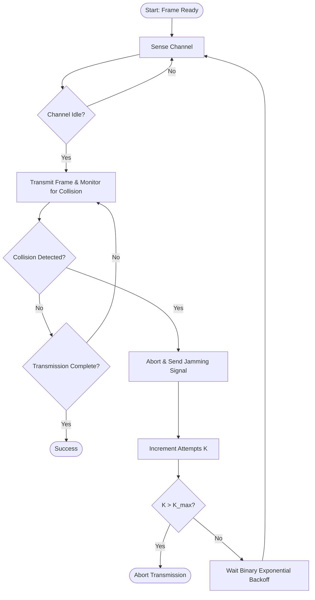
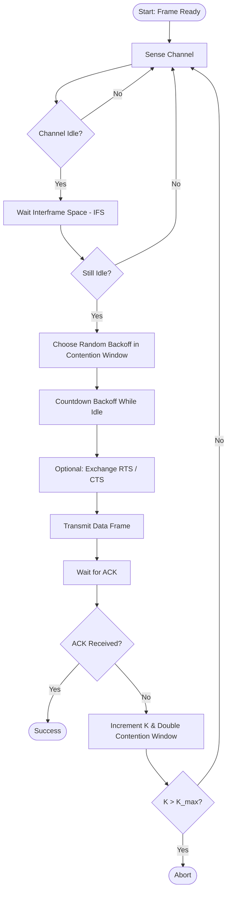

# Q16. Describe Carrier Sense Multiple Access (CSMA), CSMA/CD, and CSMA/CA channel access techniques with flow diagrams and compare them.

## 1. Carrier Sense Multiple Access (CSMA)
**CSMA** is a contention-based MAC protocol designed to reduce collisions compared to ALOHA by following the rule **"Listen Before Talk" (Carrier Sensing)**.

* **How it works:** Before transmitting, a station senses the shared medium to check if another station is currently transmitting:
  * If **idle**, it transmits (according to its persistence method).
  * If **busy**, it defers transmission.
* **Persistence Methods in CSMA:**
  1. **1-Persistent CSMA:** Continuously senses the channel; transmits immediately with probability $1$ as soon as it becomes idle.
  2. **Non-Persistent CSMA:** If busy, waits a random time before sensing again (reduces collisions, increases delay).
  3. **$p$-Persistent CSMA:** Used in slotted channels; when idle, transmits with probability $p$ or defers to the next slot with probability $(1-p)$.
* **Limitation of Basic CSMA:** Due to **propagation delay**, two stations far apart can both sense the channel as idle at the same time and transmit simultaneously, still causing a collision. **CSMA/CD** and **CSMA/CA** solve this limitation.

---

## 2. CSMA/CD (CSMA with Collision Detection)
**CSMA/CD** is used in **wired LANs (traditional Ethernet — IEEE 802.3)**. It adds **"Listen While Talking"** to basic CSMA.

### Working Mechanism
1. **Sense Channel:** Station listens to the wire. If busy, it waits until idle.
2. **Transmit & Monitor:** Station begins transmitting **and simultaneously monitors** the channel voltage/signal for a collision.
3. **Collision Detected:**
   * If a collision is detected, the station **immediately aborts** transmission to save bandwidth.
   * Sends a **Jamming Signal** (48 bits) so all other stations know a collision occurred.
   * Increments the collision counter ($K$) and waits a **Binary Exponential Backoff** time before retrying (until $K > K_{\max}$).

### CSMA/CD Flow Diagram

---

## 3. CSMA/CA (CSMA with Collision Avoidance)
**CSMA/CA** is used in **wireless LANs (Wi-Fi — IEEE 802.11)**.

### Why CSMA/CD Cannot Be Used in Wireless Networks
* Wireless transceivers cannot easily transmit and listen on the same frequency simultaneously (strong outgoing signal drowns out weak incoming signals).
* **Hidden Node Problem:** Two nodes out of range of each other cannot hear each other's transmissions, yet both collide at a central Access Point.

Therefore, **CSMA/CA** focuses on **avoiding** collisions *before* transmission using three mechanisms:
1. **Interframe Space (IFS):** Even after the channel becomes idle, the station waits an extra IFS period (e.g., DIFS) to ensure no high-priority control frames are pending.
2. **Contention Window (Random Backoff):** The station picks a random number of backoff slots and counts down only while the channel remains idle.
3. **RTS/CTS Handshaking & ACK:** Optional **Request-to-Send (RTS)** and **Clear-to-Send (CTS)** frames reserve the channel and solve the hidden node problem. Since collisions aren't detected mid-flight, an explicit **ACK** is required to confirm success.

### CSMA/CA Flow Diagram

---

## 4. Comparison: CSMA vs. CSMA/CD vs. CSMA/CA

| Feature | Basic CSMA | CSMA/CD | CSMA/CA |
| :--- | :--- | :--- | :--- |
| **Core Principle** | Listen before talk | Listen before & **during** talk | Listen before talk & **avoid** collisions |
| **Collision Handling** | Does not detect collisions; relies on upper-layer timeouts | **Detects collision mid-transmission**, aborts, sends jam signal | **Avoids collisions beforehand** using IFS, backoff, & RTS/CTS |
| **Acknowledgment (ACK)** | Optional / higher layer | Not required at MAC level (lack of collision implies success) | **Required** at MAC level (receiver sends explicit ACK) |
| **Primary Medium** | Shared broadcast links | **Wired LANs (IEEE 802.3 Ethernet)** | **Wireless LANs (IEEE 802.11 Wi-Fi)** |
| **Hidden Node Handling** | Not handled | Not applicable on wired bus | Handled via **RTS/CTS** virtual carrier sense |
| **Efficiency / Overhead** | Moderate (wastes full frame time on collision) | High (aborts collided frames immediately) | Lower than CSMA/CD due to IFS, backoff, & RTS/CTS/ACK overhead |

---

## References & Study Hints
* **Tutorial Reference:** [GeeksforGeeks – Difference between CSMA/CA and CSMA/CD](https://www.geeksforgeeks.org/computer-networks/difference-between-csma-ca-and-csma-cd/)
* **Video Lecture:** [Neso Academy – Computer Networks Playlist (YouTube)](https://www.youtube.com/hashtag/computernetworksbyneso)
* **Exam Study Hints:**
  * Clearly explain **why wireless networks use CSMA/CA instead of CSMA/CD** (cannot listen while transmitting + Hidden Node Problem).
  * Highlight the **3 avoidance mechanisms** in CSMA/CA (**IFS**, **Contention Window**, and **RTS/CTS + ACK**) and the **Jamming Signal + Binary Exponential Backoff** in CSMA/CD.
