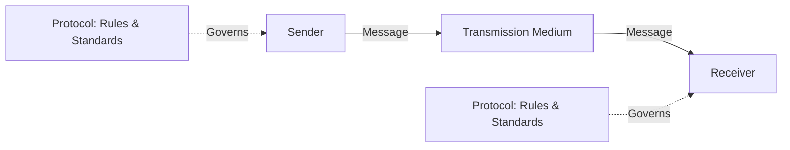

# Q7. What do you understand by Data Communication? Explain the Components of Data Communication.

## 1. Definition of Data Communication
**Data Communication** is the process of exchanging digital or analog data (such as text, numbers, audio, images, or video) between two or more devices over a transmission medium (such as a wire cable or wireless radio channel).

For data communication to be effective, a system must satisfy four fundamental characteristics:
1. **Delivery:** Data must be delivered to the correct intended destination device/user.
2. **Accuracy:** Data must arrive unaltered and free from corruption or errors.
3. **Timeliness:** Data must be delivered within an acceptable time frame (critical for real-time audio/video).
4. **Jitter:** Variation in packet arrival time should be minimal, especially for streaming media.

---

## 2. Diagram of Data Communication System



```
+----------+         Message           +----------+
|  Sender  | ========================> | Receiver |
+----------+    Transmission Medium    +----------+
     ^                                      ^
     |         Rules (Protocol)             |
     +--------------------------------------+
```

---

## 3. Five Fundamental Components of Data Communication

A data communication system consists of **five essential components**:

### 1. Message
* The **message** is the actual information or data to be communicated from sender to receiver.
* It can take various forms:
  * **Text:** Encoded using bit patterns such as ASCII or Unicode (UTF-8).
  * **Numbers:** Represented directly as binary values.
  * **Images:** Represented as a matrix of pixels (e.g., RGB bit patterns).
  * **Audio & Video:** Continuous signals digitized into bit streams.

### 2. Sender (Transmitter)
* The **sender** is the device that generates, encodes, and transmits the data message onto the communication channel.
* Examples: Computers, smartphones, workstations, servers, telephone handsets, or video cameras.

### 3. Receiver
* The **receiver** is the target device that accepts, decodes, and interprets the incoming message from the medium.
* Examples: Computers, printers, televisions, servers, or mobile devices.

### 4. Transmission Medium
* The **transmission medium** is the physical pathway or channel through which the message travels from the sender to the receiver.
* It can be:
  * **Guided (Wired):** Twisted-pair cable, coaxial cable, optical fiber cable.
  * **Unguided (Wireless):** Radio waves, microwaves, infrared waves.

### 5. Protocol
* A **protocol** is a pre-agreed set of rules, conventions, and standards that governs data communication.
* It defines *what* is communicated, *how* it is communicated, and *when* it is communicated (syntax, semantics, and timing).
* **Why it is essential:** Without a shared protocol, two devices may be physically connected but unable to understand each other—just like two people speaking different languages. Examples include **TCP/IP, HTTP, Ethernet, and SMTP**.

---

## 4. Data Flow Modes in Data Communication
Communication between sender and receiver occurs in one of three modes:
1. **Simplex:** Unidirectional communication; only one device can transmit and the other only receives (e.g., keyboard to monitor, TV broadcast).
2. **Half-Duplex:** Bidirectional communication, but **only one device can transmit at a time** (e.g., walkie-talkie).
3. **Full-Duplex:** Bidirectional communication where **both devices can transmit and receive simultaneously** (e.g., telephone call, modern switched Ethernet).

---

## References & Study Hints
* **Tutorial References:**
  * [GeeksforGeeks – Data Communication (Definition, Components, Types, Channels)](https://www.geeksforgeeks.org/computer-networks/data-communication-definition-components-types-channels/)
  * [GeeksforGeeks – Data Communication Tutorial](https://www.geeksforgeeks.org/computer-networks/data-communication-tutorial/)
* **Video Lecture:** [Neso Academy – Computer Networks Playlist (YouTube)](https://www.youtube.com/hashtag/computernetworksbyneso)
* **Exam Study Hints:**
  * Always draw the **5-component block diagram** (Sender, Receiver, Message, Transmission Medium, Protocol) at the top of your answer.
  * Mentioning the **4 effectiveness criteria** (Delivery, Accuracy, Timeliness, Jitter) and **3 data flow modes** (Simplex, Half-Duplex, Full-Duplex) makes a 5-mark answer stand out for full 8–10 marks.
