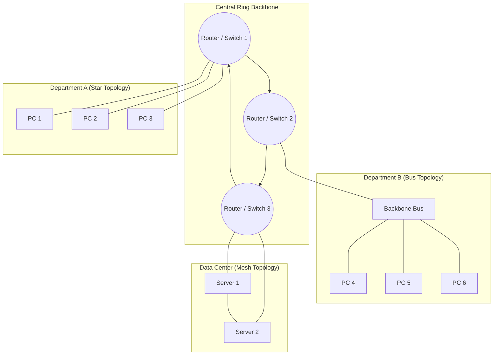

# Q3. Explain Hybrid Topology with a diagram.

## 1. Definition
A **Hybrid Topology** is a network topology formed by combining **two or more different basic topologies** (such as Star, Bus, Ring, or Mesh) into a single unified network.

Because real-world organizations have diverse departmental needs, building sizes, and reliability requirements, a single pure topology is rarely sufficient. Hybrid topology allows each segment to use the topology best suited to its requirements while interconnecting them together.

*(Note: Combining two identical topologies—for example, a Star connected to another Star—results in a Tree/Extended Star topology, not a Hybrid topology. A true Hybrid topology combines **different** basic topologies.)*

---

## 2. Diagram of Hybrid Topology (Star–Ring–Bus Hybrid)
Below is a common enterprise/campus hybrid network combining a **Ring backbone** with **Star** and **Bus** departmental sub-networks:

---

## 3. Common Types of Hybrid Topologies
1. **Star–Bus Hybrid Topology:**
   * Multiple **Star** networks are interconnected via a central linear **Bus** backbone.
   * **Example:** Connecting separate office floor switches (each forming a Star) to a main building backbone cable.
2. **Star–Ring Hybrid Topology:**
   * Multiple **Star** sub-networks are linked together using a central **Ring** backbone (e.g., Token Ring / FDDI backbone).
   * **Example:** University campus networks where each department uses a Star LAN connected to a campus-wide fiber Ring.

---

## 4. Characteristics of Hybrid Topology
* **Heterogeneous Structure:** Integrates different media, speeds, and access methods across sub-networks.
* **Modular Design:** Each branch operates semi-independently and can be upgraded or reconfigured without redesigning the entire network.
* **Customizability:** Balances cost, speed, and fault tolerance according to the criticality of each segment (e.g., Mesh for data centers, Star for user workstations).

---

## 5. Advantages and Disadvantages

### Advantages
1. **High Flexibility & Customizability:** Can be tailored to match complex physical layouts and organizational hierarchies.
2. **Effective Fault Isolation:** Faults in one sub-network (e.g., a broken drop cable in a Star branch) can be easily isolated without bringing down the rest of the network.
3. **High Scalability:** New nodes or entire sub-topologies can be added easily without disrupting existing segments.
4. **Reliability:** Critical segments can use redundant topologies (like Mesh or Dual Ring) while standard segments use cost-effective Star topologies.

### Disadvantages
1. **Complex Design & Architecture:** Designing, configuring, and integrating multiple topologies requires skilled network engineers.
2. **High Cost:** Requires expensive multi-protocol networking hardware (routers, intelligent switches, gateways) and significant cabling.
3. **Difficult Maintenance:** Managing heterogeneous protocols and troubleshooting cross-topology issues increases administrative overhead.

---

## 6. Applications
* **University Campuses:** Connecting different academic departments (Star) via a high-speed fiber backbone (Ring or Mesh).
* **Large Enterprises & Banks:** Combining secure Mesh cores for data centers with Star topologies for employee workstations.
* **Telecommunications & ISP Networks:** Integrating local access topologies with regional/national mesh backbones.

---

## References & Study Hints
* **Tutorial Reference:** [GeeksforGeeks – What is Hybrid Topology?](https://www.geeksforgeeks.org/computer-networks/what-is-hybrid-topology/)
* **Video Lecture:** [Neso Academy – Computer Networks Playlist (YouTube)](https://www.youtube.com/hashtag/computernetworksbyneso)
* **Exam Study Hints:**
  * Explicitly clarify that a Hybrid topology must combine **two or more *different* topologies** (e.g., Star + Ring or Star + Bus).
  * Draw a neat diagram clearly labeling each sub-topology (e.g., Star, Bus, Ring/Mesh) and how they interconnect.
