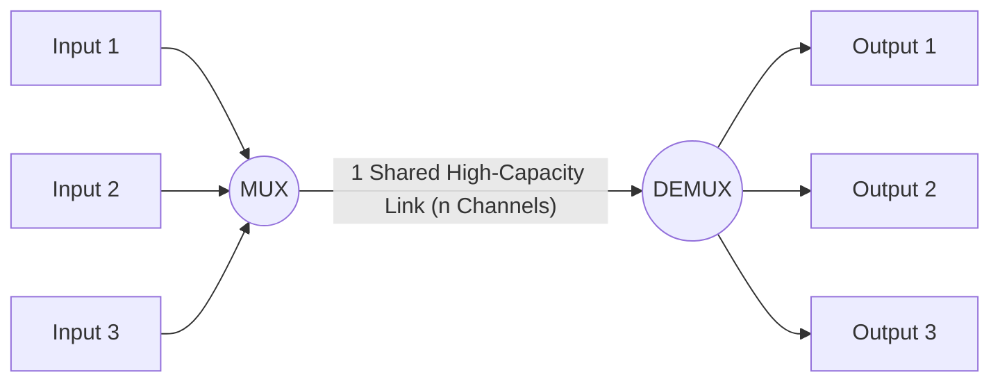

# Q11. What is multiplexing and explain its types briefly?

## 1. Definition of Multiplexing
**Multiplexing** is a Physical Layer technique used to **combine multiple low-bandwidth signals** from different sources and transmit them simultaneously over a **single shared high-bandwidth communication link (medium)**.

* **Multiplexer (MUX):** Located at the sender side; combines $n$ input lines into **1** shared communication link.
* **Demultiplexer (DEMUX):** Located at the receiver side; separates the single composite signal back into the original $n$ individual signals and routes them to their respective destinations.

**Purpose:** Maximizes bandwidth utilization and significantly reduces cabling/hardware costs when a single high-capacity link is cheaper than running $n$ separate links.

---

## 2. Types of Multiplexing

Multiplexing is broadly classified into **Analog** (FDM, WDM) and **Digital** (TDM) techniques (along with **CDM/CDMA**):

### 1. Frequency Division Multiplexing (FDM)
* **Nature:** **Analog** multiplexing technique.
* **How it works:** The total available bandwidth of the shared link is divided into **non-overlapping frequency bands (channels)**. Each input signal is modulated onto a different carrier frequency and transmitted **simultaneously**.
* **Guard Bands:** Narrow unused frequency strips placed between adjacent channels to prevent interference (crosstalk).
* **Applications:** AM/FM radio broadcasting, cable TV (CATV), 1G cellular systems.

### 2. Wavelength Division Multiplexing (WDM)
* **Nature:** **Optical (Analog)** multiplexing technique used on **fiber-optic cables**.
* **How it works:** Conceptually identical to FDM, except it combines **multiple light signals of different wavelengths (colors)** into a single optical fiber using prisms/optical multiplexers.
* **Variants:**
  * **CWDM (Coarse WDM):** Fewer channels with wider wavelength spacing.
  * **DWDM (Dense WDM):** Packs dozens/hundreds of tightly spaced wavelengths onto one fiber for massive terabit capacity.
* **Applications:** High-speed optical Internet backbones, submarine cables.

### 3. Time Division Multiplexing (TDM)
* **Nature:** **Digital** multiplexing technique.
* **How it works:** All signals share the **entire bandwidth** of the link, but take turns transmitting in **fixed or dynamic time slots**. Because slots alternate rapidly, multiple transmissions appear simultaneous.
* **Types of TDM:**
  * **Synchronous TDM (STDM):** Each input source is assigned a fixed, dedicated time slot in every frame, even if it has no data to send (unused slots are wasted).
  * **Asynchronous / Statistical TDM (ATDM):** Time slots are allocated **dynamically on demand** only to active sources with data to send, improving bandwidth efficiency.
* **Applications:** ISDN, digital telephony (T1/E1 trunks), SONET/SDH.

### 4. Code Division Multiplexing (CDM / CDMA)
* **Nature:** Digital spread-spectrum technique.
* **How it works:** All users transmit **simultaneously across the entire frequency band**, but each user's signal is multiplied by a unique **orthogonal spreading code**. Receivers use the matching code to extract their desired signal while treating others as noise.
* **Applications:** 3G mobile networks, GPS, satellite communications.

---

## 3. Summary Comparison Table

| Feature | FDM | WDM | TDM |
| :--- | :--- | :--- | :--- |
| **Signal Type** | Analog | Optical (Light) | Digital |
| **Sharing Basis** | Frequency bands | Light wavelengths | Time slots |
| **Transmission** | Simultaneous in different frequencies | Simultaneous in different wavelengths | Sequential in rapid time slots |
| **Guard Mechanism** | Guard bands | Wavelength spacing | Guard times / Frame sync bits |
| **Main Application** | Radio, Cable TV | Optical fiber backbones | Digital telephony, ISDN |

---

## References & Study Hints
* **Tutorial References:**
  * [GeeksforGeeks – Multiplexing (Channel Sharing in Computer Network)](https://www.geeksforgeeks.org/computer-networks/multiplexing-channel-sharing-in-computer-network/)
  * [GeeksforGeeks – Difference between FDM, TDM, and WDM](https://www.geeksforgeeks.org/computer-networks/difference-between-fdmtdm-and-wdm/)
* **Video Lecture:** [Neso Academy – Computer Networks Playlist (YouTube)](https://www.youtube.com/hashtag/computernetworksbyneso)
* **Exam Study Hints:**
  * Always draw the **MUX → Shared Link → DEMUX** block diagram.
  * Distinguish **Synchronous TDM** (fixed slots, can waste bandwidth) vs. **Statistical/Asynchronous TDM** (dynamic slots, higher efficiency), and mention **Guard Bands** in FDM.
