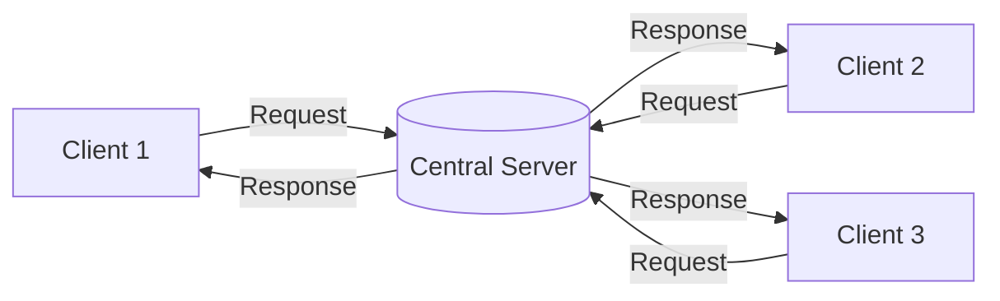
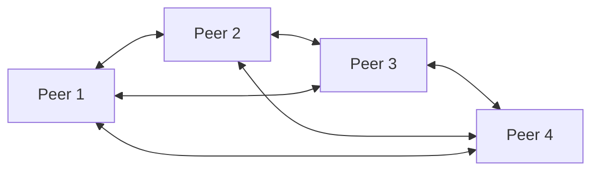

# Q1. Describe the structure and architecture of a computer network.

## 1. Introduction
A **computer network** is an interconnected collection of autonomous computing devices (nodes) linked by communication channels (wired or wireless) to share resources, exchange data, and run distributed applications.

The **structure and architecture** of a computer network define both:
1. **Physical & Structural Organization:** The hardware components, geographic span, and physical/logical interconnection of nodes.
2. **Logical / Functional Architecture:** How tasks, services, and responsibilities are distributed across nodes (Client-Server vs. Peer-to-Peer) and organized into modular protocol layers.

---

## 2. Structural Components of a Computer Network
A computer network is built from the following core structural elements:

1. **End Systems (Hosts / Nodes):** Devices that originate or consume data (e.g., PCs, laptops, smartphones, servers, IoT sensors).
2. **Communication Links (Transmission Media):** Physical pathways connecting nodes—either **guided** (twisted-pair, coaxial, optical fiber) or **unguided** (radio waves, microwaves, infrared).
3. **Intermediate Networking Devices:** Hardware that forwards, filters, or routes data between nodes:
   * **Hub / Repeater:** Regenerates signals at the physical layer.
   * **Switch / Bridge:** Forwards frames within a LAN using MAC addresses.
   * **Router / Gateway:** Routes packets across distinct networks using IP addresses.
4. **Network Software & Protocols:** Rules and software stacks (such as TCP/IP, HTTP, DNS) that govern addressing, formatting, error control, and session management.

### Structural Classification by Geographic Scale
* **PAN (Personal Area Network):** Very short range (~1–10 m), e.g., Bluetooth devices.
* **LAN (Local Area Network):** Covers a building or campus; high speed, low latency.
* **MAN (Metropolitan Area Network):** Spans a city or large metropolitan area.
* **WAN (Wide Area Network):** Spans countries or continents (e.g., the Internet).

---

## 3. Types of Network Architecture

### A. Client-Server Architecture
In a **Client-Server** architecture, network roles are strictly divided into two types of nodes under centralized control:
* **Server:** A dedicated, high-capacity system that hosts resources, manages data, authenticates users, and responds to service requests (e.g., Web Server, Mail Server, Database Server).
* **Client:** A user device or application that initiates requests to the server and consumes the returned services.

* **Advantages:** Centralized security, easier backup and administration, high scalability with load balancers.
* **Disadvantages:** Single point of failure (if the server goes down, services stop), higher hardware and maintenance cost, potential server bottleneck under heavy load.

---

### B. Peer-to-Peer (P2P) Architecture
In a **Peer-to-Peer (P2P)** architecture, there is no central server. All participating computers (**peers**) have equal status and capabilities:
* **Dual Role:** Every node acts as **both a client and a server** simultaneously—capable of requesting resources from others and sharing its own resources.
* **Decentralized Control:** Peers communicate directly with one another without centralized coordination.

* **Advantages:** Cost-effective (no dedicated server needed), no single point of failure, easy to set up for small networks, scales organically as peers contribute resources.
* **Disadvantages:** Weak centralized security, difficult backup and data consistency, performance depends on active peers.

---

### C. Layered Network Architecture
To manage complexity, modern networks use a **layered architecture** (such as the **7-layer OSI model** or **4-layer TCP/IP model**). Each layer:
* Performs a specific, well-defined function (e.g., physical bit transmission, framing, routing, reliable transport, application services).
* Communicates with the layer directly above and below it via **interfaces** and with its corresponding peer layer on another host via **protocols**.

---

## 4. Comparison: Client-Server vs. Peer-to-Peer Architecture

| Feature | Client-Server Architecture | Peer-to-Peer (P2P) Architecture |
| :--- | :--- | :--- |
| **Control** | Centralized (managed by server) | Decentralized (distributed among peers) |
| **Node Roles** | Dedicated clients and servers | Every node acts as both client and server |
| **Security** | High (centralized authentication/policies) | Lower (harder to enforce uniformly) |
| **Cost** | High (dedicated server hardware & IT staff) | Low (uses existing peer hardware) |
| **Fault Tolerance** | Server is a single point of failure | High resilience; no single point of failure |
| **Examples** | Web browsing, email, online banking | BitTorrent, small home/office LANs |

---

## References & Study Hints
* **Tutorial Reference:** [GeeksforGeeks – Classification of Computer Network on Basis of Architecture](https://www.geeksforgeeks.org/computer-networks/classification-of-computer-network-on-basis-of-architecture/)
* **Video Lecture:** [Neso Academy – Computer Networks Playlist (YouTube)](https://www.youtube.com/hashtag/computernetworksbyneso)
* **Exam Study Hints:**
  * Always cover **both** structural aspects (nodes, links, devices, LAN/MAN/WAN) and architectural models (**Client-Server**, **P2P**, and **Layered Architecture**).
  * Draw simple block diagrams for Client-Server vs. P2P and include a 4–5 row comparison table to secure full 8–10 marks.
