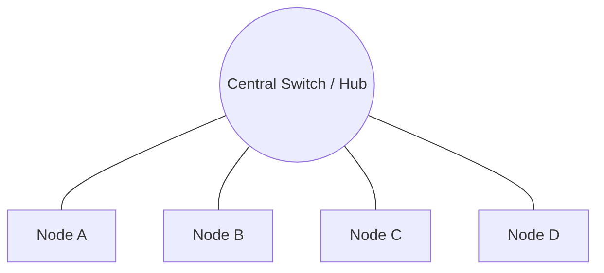
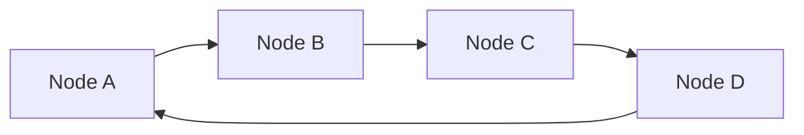
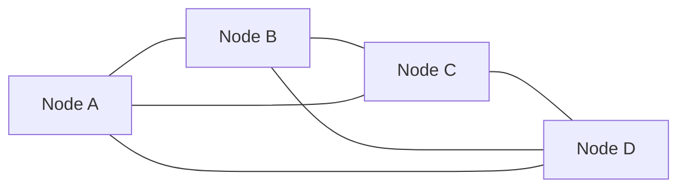
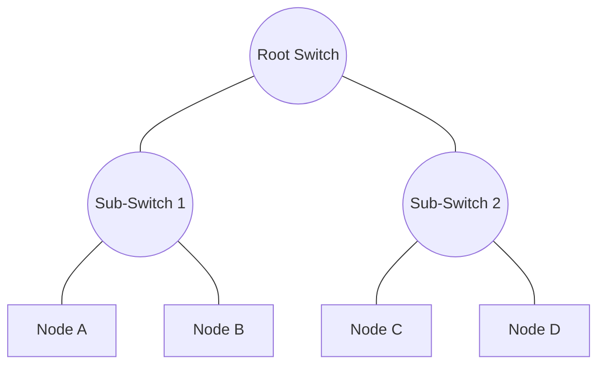

# Q2. Explain different network topologies with neat diagrams.

## 1. Introduction
**Network Topology** refers to the physical or logical geometric arrangement of nodes (devices) and communication links in a computer network.
* **Physical Topology:** How cables and hardware devices are physically laid out.
* **Logical Topology:** How data actually flows through the network regardless of physical wiring.

The five primary network topologies are **Bus, Star, Ring, Mesh, and Tree** (along with **Hybrid**, which combines two or more topologies).

---

## 2. Types of Network Topologies

### 1. Bus Topology
All devices connect to a single central cable called the **backbone** (or bus) using drop lines and taps. **Terminators** are placed at both ends of the backbone to absorb signals and prevent reflection.

```
[Node A]       [Node B]       [Node C]       [Node D]
   |              |              |              |
===+==============+==============+==============+===  <-- Backbone Cable
(Terminator)                                (Terminator)
```

* **Advantages:**
  * Low cabling cost and simple to install for small networks.
  * Failure of a single node does not affect the rest of the network.
* **Disadvantages:**
  * Backbone cable is a single point of failure—if it breaks, the entire network stops.
  * Difficult to troubleshoot and isolate faults.
  * Performance degrades rapidly as traffic or the number of nodes increases due to collisions.

---

### 2. Star Topology
Every device has a dedicated point-to-point link to a **central device** (typically a **switch** or **hub**). All communication passes through this central node.



* **Advantages:**
  * **High Fault Tolerance (per link):** If one cable or node fails, only that node is affected.
  * **Easy Troubleshooting & Scalability:** Easy to add, remove, or diagnose nodes at the central switch.
  * **No Collisions (with Switch):** Dedicated links prevent shared-bus collisions.
* **Disadvantages:**
  * **Single Point of Failure:** If the central hub/switch fails, the entire network goes down.
  * Requires more cable than a bus topology, increasing installation cost.

---

### 3. Ring Topology
Each device is connected to exactly **two** neighboring devices, forming a closed circular loop. Data travels from node to node around the ring (unidirectionally in a single ring, or bidirectionally in a dual ring), often controlled by a **token**.



* **Advantages:**
  * Ordered, collision-free transmission (especially with token passing).
  * Equal access to the network for every node; performs well under heavy load.
* **Disadvantages:**
  * **Single Point of Failure (Single Ring):** A break in any link or failure of one node disrupts the entire ring.
  * Difficult to add or remove devices without interrupting network operation.

---

### 4. Mesh Topology
In a **Mesh** topology, devices are interconnected with multiple point-to-point links:
* **Full Mesh:** Every node is directly connected to every other node. For $n$ nodes, total links required = $\frac{n(n-1)}{2}$, and each node needs $(n-1)$ I/O ports.
* **Partial Mesh:** Only critical or heavily communicating nodes are fully interconnected; others connect to a subset of nodes.



* **Advantages:**
  * **Maximum Reliability & Fault Tolerance:** Multiple redundant paths exist; if one link fails, traffic reroutes.
  * **High Privacy & Security:** Dedicated links prevent eavesdropping by other nodes.
  * **No Traffic Congestion:** Each link carries only its own dedicated traffic.
* **Disadvantages:**
  * **Very High Cost:** Massive cabling and hardware port requirements ($\frac{n(n-1)}{2}$ links).
  * Complex installation, configuration, and maintenance.

---

### 5. Tree Topology (Hierarchical Topology)
A **Tree** topology combines characteristics of **Star** and **Bus** topologies in a hierarchical structure. A central **root** node connects to secondary hubs/switches, which in turn connect to end devices in star clusters.



* **Advantages:**
  * Highly scalable; easy to expand by adding new star branches.
  * Fault isolation is easy within individual branches.
* **Disadvantages:**
  * If the root node or main backbone fails, large segments (or the entire network) lose connectivity.
  * Heavy cabling requirement and complex maintenance for large trees.

---

## 3. Comparison Table of Network Topologies

| Topology | Links for $n$ Nodes | Fault Tolerance | Cabling Cost | Troubleshooting | Primary Use Case |
| :--- | :--- | :--- | :--- | :--- | :--- |
| **Bus** | $1$ backbone + $n$ drops | Low (backbone break fails all) | Low | Difficult | Legacy small LANs |
| **Star** | $n$ links | Moderate (central hub is critical) | Moderate | Easy | Modern Ethernet LANs |
| **Ring** | $n$ links | Low (single ring) / High (dual ring) | Moderate | Moderate | Token Ring, FDDI |
| **Mesh** | $\frac{n(n-1)}{2}$ (Full Mesh) | Very High | Very High | Easy (point-to-point) | WAN backbones, critical systems |
| **Tree** | Hierarchical | Moderate (root is critical) | High | Moderate | Campus & enterprise networks |

---

## References & Study Hints
* **Tutorial References:**
  * [GeeksforGeeks – Network Topology](https://www.geeksforgeeks.org/computer-networks/network-topology/)
  * [GeeksforGeeks – Difference between Mesh Topology and Bus Topology](https://www.geeksforgeeks.org/computer-networks/difference-between-mesh-topology-and-bus-topology/)
* **Video Lecture:** [Neso Academy – Computer Networks Playlist (YouTube)](https://www.youtube.com/hashtag/computernetworksbyneso)
* **Exam Study Hints:**
  * Draw **neat, labeled diagrams** for each topology (including terminators in Bus and central switch in Star).
  * Always mention the **Full Mesh link formula** $\frac{n(n-1)}{2}$—examiners frequently look for this!
