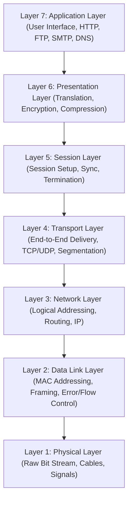

# Q5. Explain the key features of the OSI reference model.

## 1. Introduction
The **OSI (Open Systems Interconnection) Reference Model** was developed by the **International Organization for Standardization (ISO)** in 1984. It is a standardized **7-layer conceptual framework** that describes how data is transmitted between two heterogeneous systems over a network, enabling interoperability between products from different vendors.

---

## 2. The 7-Layer OSI Architecture Diagram

---

## 3. Key Features of the OSI Reference Model

### 1. Layered Modular Architecture (7 Distinct Layers)
The complex task of network communication is divided into **seven independent, manageable layers**:
* **Upper Layers (5–7 — Host/Software Layers):** Application, Presentation, and Session layers focus on user applications, data formatting, and session control.
* **Transport Layer (4):** Bridges the upper application layers and the lower network layers, providing reliable end-to-end delivery.
* **Lower Layers (1–3 — Media/Hardware Layers):** Network, Data Link, and Physical layers handle routing, framing, and physical bit transmission.

### 2. Clear Separation of Services, Interfaces, and Protocols
The OSI model strictly distinguishes three fundamental concepts:
* **Service:** *What* a layer does for the layer directly above it (without revealing *how* it is implemented).
* **Interface:** *How* processes above a layer access its services (via Service Access Points / SAPs).
* **Protocol:** The set of rules governing communication between **peer layers** on different machines.

### 3. Protocol Independence & Vendor Neutrality
The OSI model is a **generic reference model**, not tied to any specific protocol suite or hardware vendor. Any protocol (such as Ethernet, IP, or HTTP) can be mapped to its layers, promoting **open standards** and cross-vendor compatibility.

### 4. Encapsulation and Decapsulation
As data moves down the protocol stack on the sender side, each layer adds its own **header** (and trailer at Layer 2), creating a specific **Protocol Data Unit (PDU)**:
* **Layers 5–7:** Data
* **Layer 4 (Transport):** Segment (TCP) / Datagram (UDP)
* **Layer 3 (Network):** Packet
* **Layer 2 (Data Link):** Frame
* **Layer 1 (Physical):** Bits

At the receiver, each layer strips off its corresponding header (**decapsulation**) and passes the payload upward.

### 5. Peer-to-Peer Logical Communication
Although physical data travels vertically down the sender's stack, across the physical medium, and vertically up the receiver's stack, **each layer logically communicates directly with its corresponding peer layer** on the remote system using its layer-specific protocol.

### 6. Built-in Abstraction & Maintainability
Changes in one layer (e.g., upgrading copper cables to optical fiber at Layer 1, or switching from IPv4 to IPv6 at Layer 3) do **not** require rewriting the layers above or below, as long as the interface remains unchanged.

### 7. Support for Connection-Oriented & Connectionless Services
The OSI model supports both **connection-oriented** (reliable, ordered delivery with setup/teardown) and **connectionless** (best-effort, independent packets) communication at both the Network and Transport layers.

---

## 4. Summary of the 7 Layers

| Layer | Name | Key Functions | PDU | Examples / Protocols |
| :--- | :--- | :--- | :--- | :--- |
| **7** | **Application** | Network services to user applications | Data | HTTP, FTP, SMTP, DNS |
| **6** | **Presentation** | Data translation, encryption, compression | Data | SSL/TLS, JPEG, ASCII |
| **5** | **Session** | Dialog control, synchronization, checkpoints | Data | NetBIOS, RPC, PPTP |
| **4** | **Transport** | Process-to-process delivery, flow & error control | Segment | TCP, UDP |
| **3** | **Network** | Logical addressing (IP), packet routing | Packet | IP, ICMP, OSPF |
| **2** | **Data Link** | Physical addressing (MAC), framing, error detection | Frame | Ethernet (802.3), PPP |
| **1** | **Physical** | Raw bit transmission over physical medium | Bits | Cables, Hubs, Repeaters |

---

## References & Study Hints
* **Tutorial Reference:** [GeeksforGeeks – OSI, TCP/IP and Hybrid Models](https://www.geeksforgeeks.org/computer-networks/osi-tcp-ip-and-hybrid-models/)
* **Video Lecture:** [Neso Academy – OSI Model (YouTube)](https://www.youtube.com/watch?v=oQzueBVyAM4)
* **Exam Study Hints:**
  * Don't just list the 7 layers—explicitly highlight the **key features** (layering, separation of services/interfaces/protocols, encapsulation/PDUs, protocol independence, peer-to-peer communication).
  * Memorize the PDU names (**Data → Segment → Packet → Frame → Bits**) as they are frequently tested.
