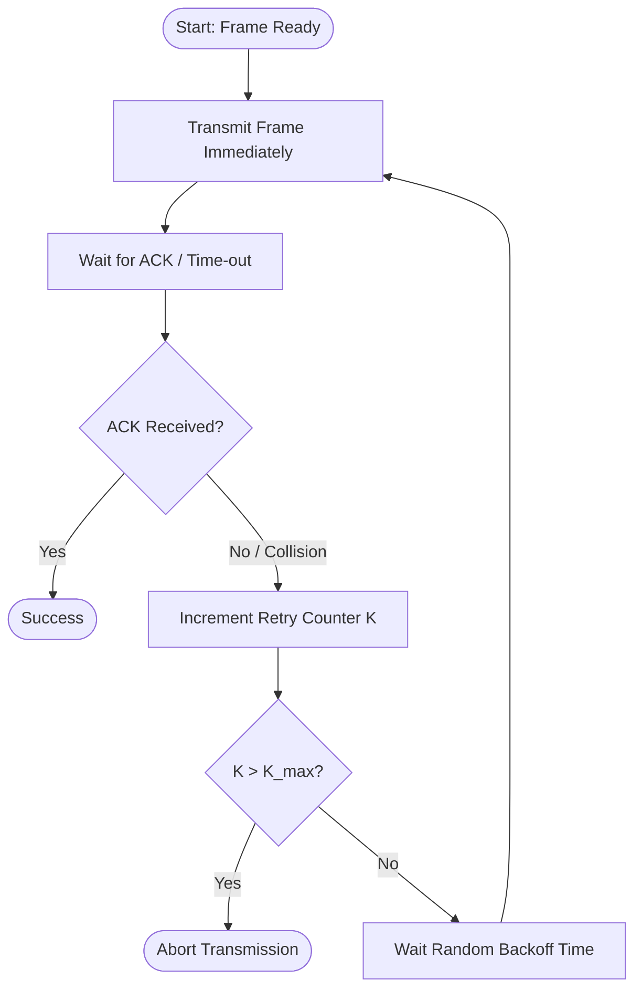
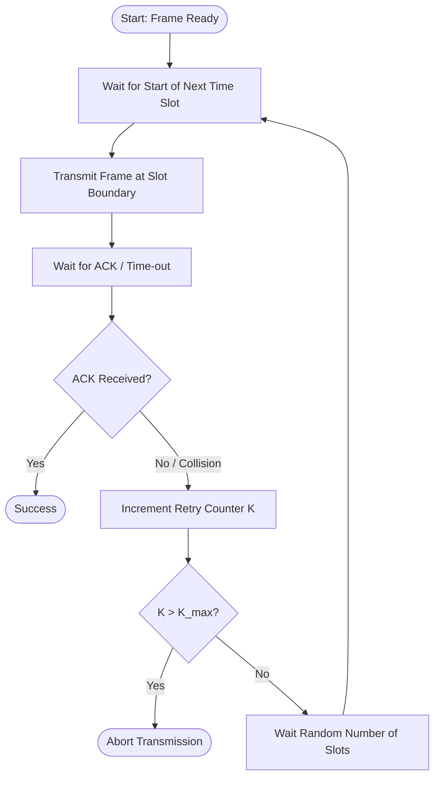

# Q15. Compare and contrast Pure ALOHA and Slotted ALOHA with proper flow diagrams.

## 1. Introduction
**ALOHA** is a classic **Random Access (Contention-based) MAC protocol** originally developed at the University of Hawaii in the 1970s for wireless radio networks. It allows multiple stations to share a common communication channel without centralized coordination.

There are two versions of ALOHA:
1. **Pure ALOHA:** Stations transmit **at any time** whenever they have a frame ready.
2. **Slotted ALOHA:** Time is divided into discrete, synchronized **time slots**, and stations can transmit **only at the beginning of a slot**.

---

## 2. Pure ALOHA

### Working Principle
* A station transmits a frame **immediately** whenever data is ready, **without sensing the channel**.
* After sending, the station waits for an **acknowledgment (ACK)** from the receiver (or listens to the broadcast channel for a round-trip time).
* If two or more frames overlap—even by **1 bit**—a **collision** occurs and both frames are destroyed.
* On collision/timeout, each station waits a **random backoff time** ($T_B$) and retransmits (up to a maximum number of attempts $K_{\max}$).

### Pure ALOHA Flow Diagram

### Vulnerable Time & Throughput (Pure ALOHA)
* **Vulnerable Time ($T_{\text{vuln}}$):** If frame transmission time is $T_t$, another frame can collide if it starts anywhere within $T_t$ before or $T_t$ after the start of our frame:
  $$T_{\text{vuln}} = 2 \times T_t$$
* **Throughput:** $S = G \cdot e^{-2G}$ (where $G$ = average number of frames generated per frame time $T_t$).
* **Maximum Efficiency:** Occurs at $G = 0.5$:
  $$S_{\max} = \frac{1}{2e} \approx 0.184 \text{ or } \mathbf{18.4\%}$$

---

## 3. Slotted ALOHA

### Working Principle
* Introduced to improve Pure ALOHA's low efficiency by **eliminating partial frame overlaps**.
* Time is divided into equal discrete intervals called **slots**, each of duration $T_t$ (equal to one frame transmission time).
* A station **must wait until the start of the next time slot** to transmit its frame.
* Collisions can only occur if two or more stations transmit in the **exact same slot**.

### Slotted ALOHA Flow Diagram

### Vulnerable Time & Throughput (Slotted ALOHA)
* **Vulnerable Time ($T_{\text{vuln}}$):** Because transmissions align strictly with slot boundaries, partial overlaps are impossible:
  $$T_{\text{vuln}} = T_t$$
* **Throughput:** $S = G \cdot e^{-G}$
* **Maximum Efficiency:** Occurs at $G = 1$:
  $$S_{\max} = \frac{1}{e} \approx 0.368 \text{ or } \mathbf{36.8\%}$$
  *(Exact **double** the maximum efficiency of Pure ALOHA!)*

---

## 4. Comparison Table: Pure ALOHA vs. Slotted ALOHA

| Feature | Pure ALOHA | Slotted ALOHA |
| :--- | :--- | :--- |
| **Transmission Timing** | Station transmits **at any time** | Station transmits **only at the start of a time slot** |
| **Time Synchronization** | **Not required** (continuous time) | **Required** (all stations synchronized to slot boundaries) |
| **Collision Type** | Partial or complete frame overlap | Complete slot overlap only (no partial overlaps) |
| **Vulnerable Period** | $2 \times T_t$ | $T_t$ (half of Pure ALOHA) |
| **Throughput Formula** | $S = G \cdot e^{-2G}$ | $S = G \cdot e^{-G}$ |
| **Optimal Load ($G$)** | $G = 0.5$ | $G = 1.0$ |
| **Maximum Efficiency** | $\frac{1}{2e} \approx \mathbf{18.4\%}$ | $\frac{1}{e} \approx \mathbf{36.8\%}$ |
| **Implementation Complexity** | Simpler | Slightly more complex (requires global clock sync) |

---

## References & Study Hints
* **Tutorial Reference:** [GeeksforGeeks – Differences between Pure and Slotted ALOHA](https://www.geeksforgeeks.org/computer-networks/differences-between-pure-and-slotted-aloha/)
* **Video Lecture:** [Neso Academy – Pure & Slotted ALOHA (YouTube)](https://www.youtube.com/watch?v=j4-r0e7DjqY)
* **Exam Study Hints:**
  * Always include **both flow diagrams**, the **vulnerable time ($2T_t$ vs. $T_t$)**, and the **maximum throughput values ($18.4\%$ vs. $36.8\%$)**—these are standard exam marking points.
  * Remember: Slotted ALOHA doubles throughput by eliminating partial collisions, at the cost of requiring **time synchronization**.
