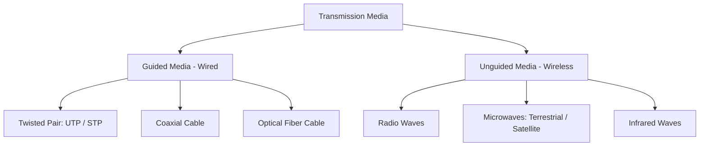

# Q9. Explain the types of transmission media used in data communication.

## 1. Introduction
**Transmission Media** (or communication channels) are the physical paths or carriers located below the Physical Layer (Layer 1) that carry electromagnetic signals from a sender to a receiver.

Transmission media are broadly classified into two main categories:
1. **Guided Media (Wired / Bounded)**
2. **Unguided Media (Wireless / Unbounded)**

---

## 2. Guided Transmission Media (Wired / Bounded)
In **guided media**, signals are directed and confined within a solid physical conductor or fiber. They generally offer higher security, lower external interference, and predictable performance.

### A. Twisted Pair Cable
Consists of **two insulated copper conductors twisted around each other** in a helical pattern. Twisting cancels out electromagnetic interference (EMI) and crosstalk from adjacent pairs.
* **Unshielded Twisted Pair (UTP):**
  * No metallic shield; inexpensive, flexible, and easy to install.
  * Used in Ethernet LANs (Cat5e, Cat6, Cat6a with RJ45 connectors) and telephone lines.
* **Shielded Twisted Pair (STP):**
  * Each pair (or the bundle) is wrapped in a metal foil or braided shield to reduce EMI/noise.
  * More expensive and bulkier than UTP; used in noisy industrial environments.

### B. Coaxial Cable
Contains a **central solid/stranded copper core** surrounded by an insulating dielectric layer, a **braided metallic shield** (outer conductor that blocks EMI), and an outer protective plastic jacket.
* **Characteristics:** Higher bandwidth and better noise immunity than twisted pair.
* **Applications:** Cable television (CATV), broadband internet, and legacy Ethernet (10BASE2, 10BASE5).

### C. Optical Fiber Cable
Transmits data as **pulses of light** through ultra-pure glass or plastic core strands using the principle of **Total Internal Reflection** (light bounces inside a higher-refractive-index core surrounded by a lower-refractive-index cladding).
* **Modes:** Single-mode (long distance, laser source) and Multimode (shorter distance, LED/laser).
* **Advantages:** Extremely high bandwidth (Gbps–Tbps), very low attenuation over long distances, complete immunity to electromagnetic interference (EMI), and high security (hard to tap).
* **Disadvantages:** Expensive, fragile (requires careful splicing/installation), unidirectional without dual fibers.
* **Applications:** Internet backbones, submarine cables, FTTH (Fiber-to-the-Home), data centers.

---

## 3. Unguided Transmission Media (Wireless / Unbounded)
In **unguided media**, electromagnetic waves propagate through air, vacuum, or water **without a physical conductor**, using antennas to transmit and receive signals.

### A. Radio Waves
* **Frequency Range:** ~3 kHz to 1 GHz.
* **Propagation:** **Omnidirectional** (radiates in all directions; sending and receiving antennas do not need to be aligned). Can penetrate walls and travel long distances.
* **Applications:** AM/FM radio, television broadcasting, Wi-Fi, Bluetooth, cellular networks.

### B. Microwaves
* **Frequency Range:** ~1 GHz to 300 GHz.
* **Propagation:** **Unidirectional** (**line-of-sight** propagation; transmitting and receiving dish antennas must be precisely aligned). Cannot easily penetrate solid obstacles like buildings.
* **Types:**
  * **Terrestrial Microwave:** Line-of-sight parabolic dish towers spaced ~30–50 km apart.
  * **Satellite Microwave:** Earth stations transmit signals up to an orbiting satellite (uplink), which amplifies and retransmits them back to Earth (downlink), covering vast geographic areas.
* **Applications:** Long-distance telecommunications, cellular backhaul, GPS, satellite TV/Internet.

### C. Infrared Waves
* **Frequency Range:** ~300 GHz to 400 THz.
* **Propagation:** Short-range, line-of-sight; **cannot penetrate solid walls**.
* **Advantages:** High security within a closed room; no interference between adjacent rooms; no government licensing required.
* **Disadvantages:** Useless outdoors in direct sunlight or over long distances.
* **Applications:** TV remote controls, short-range wireless peripherals (IrDA).

---

## 4. Comparison: Guided vs. Unguided Media

| Feature | Guided Media (Wired) | Unguided Media (Wireless) |
| :--- | :--- | :--- |
| **Signal Path** | Confined inside physical cables/fibers | Propagates freely through air or vacuum |
| **Mobility** | Fixed / tethered | High mobility |
| **Interference / Noise** | Low (especially Optical Fiber & STP) | High (affected by weather, walls, EMI) |
| **Security** | High (physical access needed to tap) | Lower (signals can be intercepted; needs encryption) |
| **Installation** | Costly/laborious for long distances or rough terrain | Easier and faster to deploy across wide/remote areas |

---

## References & Study Hints
* **Tutorial References:**
  * [GeeksforGeeks – Unguided Media](https://www.geeksforgeeks.org/computer-networks/unguided-media/)
  * [GeeksforGeeks – Data Communication (Definition, Components, Types, Channels)](https://www.geeksforgeeks.org/computer-networks/data-communication-definition-components-types-channels/)
* **Video Lecture:** [Neso Academy – Computer Networks Playlist (YouTube)](https://www.youtube.com/hashtag/computernetworksbyneso)
* **Exam Study Hints:**
  * Draw the **classification tree diagram** (Transmission Media → Guided & Unguided → 3 subtypes each) at the beginning.
  * Highlight **Total Internal Reflection** for Optical Fiber and **Omnidirectional vs. Line-of-Sight** for Radio Waves vs. Microwaves/Infrared.
