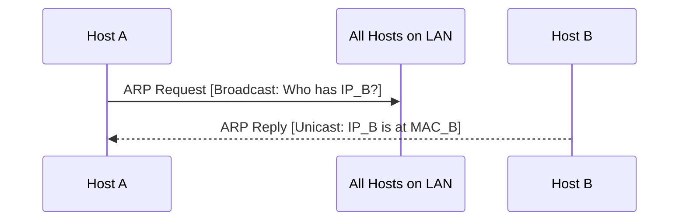

# Q15. Short Notes: ARP, ICMP, and IP Fragmentation

> **Exam Weightage:** 9–10 Marks (3 $\times$ 3 Marks) | **Module 2:** Network Layer

---

## (i) ARP (Address Resolution Protocol)

### Definition
**ARP (Address Resolution Protocol)** is a protocol that dynamically maps a known **32-bit logical IPv4 address** to an unknown **48-bit physical MAC address** on a Local Area Network (LAN).

### Why It Is Needed
At Layer 3, packets are addressed using IP addresses, but at Layer 2 (Ethernet/Wi-Fi), frames can only be delivered on a local link using physical **MAC addresses**.

### Working Steps
1. **Check ARP Cache:** Host A checks its local ARP table for Host B's IP-to-MAC mapping.
2. **ARP Request (Broadcast):** If not found, Host A broadcasts an **ARP Request** (`FF:FF:FF:FF:FF:FF`) to all devices on the LAN: *"Who has IP `B`? Tell IP `A` (MAC `A`)."*
3. **ARP Reply (Unicast):** Only Host B recognizes its own IP and sends a **unicast ARP Reply** back to Host A containing its MAC address.
4. **Update Cache:** Host A stores `(IP_B → MAC_B)` in its ARP cache for future frames.

*(Note: IPv6 replaces ARP with Neighbor Discovery Protocol – NDP.)*

---

## (ii) ICMP (Internet Control Message Protocol)

### Definition
**ICMP (Internet Control Message Protocol)** is a supporting Network Layer protocol (encapsulated inside IP, Protocol = `1`) used for **error reporting**, **operational feedback**, and **network diagnostics**—not for transporting user data.

### Key Categories of ICMP Messages
1. **Error-Reporting Messages** (sent back to the original source IP when a router/host encounters a problem):
   - **Destination Unreachable (Type 3):** Host, network, or port is unreachable, or *Fragmentation Needed & DF Set* (Code 4).
   - **Time Exceeded (Type 11):** Packet's **TTL reached 0** in transit (prevents infinite routing loops).
   - **Parameter Problem (Type 12):** Invalid header field.
   - **Redirect (Type 5):** Advises a host of a better next-hop router.
2. **Query / Diagnostic Messages:**
   - **Echo Request (Type 8) & Echo Reply (Type 0):** Used by the **`ping`** utility to test reachability and measure Round-Trip Time (RTT).
   - **`traceroute`:** Uses incrementing TTL values + ICMP *Time Exceeded* replies to map every router hop along a path.

---

## (iii) IP Fragmentation

### Definition
**IP Fragmentation** is the process of breaking a large IP datagram into smaller pieces (**fragments**) when it must pass through a physical network link whose **Maximum Transmission Unit (MTU)** is smaller than the packet size (e.g., Ethernet MTU = `1500` bytes).

### How Fragmentation Works (IPv4 Header Fields)
Three 32-bit-row fields in the IPv4 header manage fragmentation and reassembly:
1. **Identification (16 bits):** Same ID is copied into all fragments of the same original packet.
2. **Flags (3 bits):**
   - **DF (Don't Fragment):** If `1`, routers drop the packet instead of fragmenting and return an ICMP *Fragmentation Needed* message (used in **Path MTU Discovery**).
   - **MF (More Fragments):** `1` for all fragments except the **last fragment** (`MF = 0`).
3. **Fragment Offset (13 bits):** Indicates where each fragment's payload belongs in the original datagram, measured in **8-byte units**.

### Key Rule: Where Reassembly Happens
- **Fragmentation** can be performed by the **source host or any intermediate router** (in IPv4).
- **Reassembly** is performed **ONLY at the final destination host** (so intermediate routers do not waste memory/CPU waiting for fragments that might take different paths).

---

## References & Study Hints

- **GeeksforGeeks – Address Resolution Protocol (ARP):** [GeeksforGeeks ARP](https://vertexaisearch.cloud.google.com/grounding-api-redirect/AUZIYQGq44ANaovarr2ZaQiozO669I7zuDyOmKkbLtPLsaPuF0ikyVO_Uu2ZikGsAiJqyxLmr3DfeYzPNGizrggZcjkn9CsuGgjdGTJlv_Pak_4Bez74SSyit_BkfbwGJPAyGFg92BuDfxy-WEKcjmsHG2y0_Ch8llIosDJFMkYAQq3aj6k=)
- **GeeksforGeeks – ICMP:** [GeeksforGeeks ICMP](https://vertexaisearch.cloud.google.com/grounding-api-redirect/AUZIYQH3VtbluTumRZ6jTwWYVYKNWxKSJ4-lUw75CwZBJNb58epvzQl6SJ7TJq4AVUBJciXDSyioL81pYWy7BrLleQ4ufGEny4S-HokoMiJq6ta-L0KGcjzh-8jLj4J06vyOyczAbPJ1Pg_dEhtroxF_gb4FzQRbTVFuZQ_yv9d_cPU=)
- **GeeksforGeeks – IP Fragmentation:** [GeeksforGeeks Fragmentation](https://vertexaisearch.cloud.google.com/grounding-api-redirect/AUZIYQEBJzfxtClA_SiyFb5EoRB0DMlbawj8-5ZOHepoUwWpYWzxMkexhJ_qQD53Ec8P0gWrbeD4Y68GH9zuRF1SJjCUuNv9NRJqQmI9F7cE5t0qcQBOkskZ4I2zpt-JUn8Uu099UVU0tlqC8AY5d6ZorFMdiaCWxfIOMO7ecbrKdMPGD_Rt)
- **Cloudflare – Path MTU & ICMP Fragmentation:** [Cloudflare PMTUD](https://vertexaisearch.cloud.google.com/grounding-api-redirect/AUZIYQFYmleeh3pSUVLpr3g-R6ZO1jdYXWFe0ggcUAKnWwsmYfdv6eqZYy8ZQwNT9l9gtdfp3Z-DuW6KAxQdlz77sPHoUtyJNXwPk1DmmSwf6eSmK_gKiX5rfL_MnBv12rRvn60dz0MwsF_9LT2hAcAG)
- **Exam Tip:** For short notes, keep each section crisp: **Definition + Purpose + Working/Fields + Real-World Example (`ping`/`traceroute`, Ethernet MTU 1500)**.
