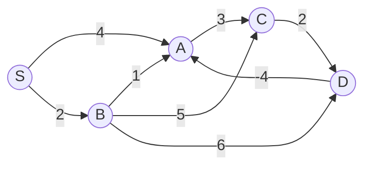

# Q13. Bellman-Ford Shortest Path Algorithm (for Source Node S)

> **Exam Weightage:** 8–10 Marks | **Module 2:** Network Layer

> **Note on Question Input:** The exact edge weights of the directed graph with nodes `S, A, B, C, D` were not included in the question text. Below is the complete **Bellman-Ford Algorithm**, followed by a **full step-by-step worked example** on a standard 5-node directed weighted graph (`S, A, B, C, D`) so you can apply the exact same procedure to any given edge weights in your exam.

---

## 1. Overview of the Bellman-Ford Algorithm

The **Bellman-Ford Algorithm** is a **single-source shortest path** algorithm based on **Dynamic Programming** and **Edge Relaxation**.
- **Key Advantage over Dijkstra:** It works with **negative edge weights** and can **detect negative-weight cycles**.
- **Networking Relevance:** Forms the mathematical basis of **Distance Vector Routing** protocols (e.g., RIP).
- **Time Complexity:** $O(V \cdot E)$, where $V$ is the number of vertices and $E$ is the number of edges.

---

## 2. Algorithm Steps

Given a directed weighted graph $G = (V, E)$ with source vertex $S$:

1. **Initialization:**
   - Set `dist[S] = 0` and `pred[S] = NULL`.
   - For every other vertex $v \in V \setminus \{S\}$, set `dist[v] = ∞` and `pred[v] = NULL`.

2. **Edge Relaxation ($|V| - 1$ Iterations):**
   - Repeat the following **$V - 1$ times**:
     - For every directed edge $(u, v)$ with weight $w(u, v)$:
       $$\text{If } \text{dist}[u] \neq \infty \text{ and } \text{dist}[u] + w(u, v) < \text{dist}[v]:$$
       $$\text{dist}[v] = \text{dist}[u] + w(u, v), \quad \text{pred}[v] = u$$
   - *Why $V - 1$ times?* A simple shortest path in a graph with $V$ vertices can have at most $V - 1$ edges.

3. **Negative-Weight Cycle Detection ($V$-th Check):**
   - Run one extra pass over all edges $(u, v)$.
   - If any edge still satisfies $\text{dist}[u] + w(u, v) < \text{dist}[v]$, then a **negative-weight cycle** exists (no finite shortest path exists).

---

## 3. Worked Illustrative Example (`S, A, B, C, D`)

Consider the following directed weighted graph with $V = 5$ vertices $\{S, A, B, C, D\}$ and $E = 8$ edges:

**Edge List (in relaxation order):**
`S→A (4)`, `S→B (2)`, `B→A (1)`, `A→C (3)`, `B→C (5)`, `B→D (6)`, `C→D (2)`, `D→A (-4)`

### Step 1: Initialization
| Node | `S` | `A` | `B` | `C` | `D` |
| :--- | :---: | :---: | :---: | :---: | :---: |
| **Distance `dist[]`** | **0** | $\infty$ | $\infty$ | $\infty$ | $\infty$ |
| **Predecessor `pred[]`** | `-` | `-` | `-` | `-` | `-` |

### Step 2: Run $V - 1 = 5 - 1 = 4$ Iterations

#### Iteration 1
- `S→A (4)`: $0 + 4 < \infty \implies$ `dist[A] = 4`, `pred[A] = S`
- `S→B (2)`: $0 + 2 < \infty \implies$ `dist[B] = 2`, `pred[B] = S`
- `B→A (1)`: $2 + 1 = 3 < 4 \implies$ `dist[A] = 3`, `pred[A] = B` *(updated!)*
- `A→C (3)`: $3 + 3 = 6 < \infty \implies$ `dist[C] = 6`, `pred[C] = A`
- `B→C (5)`: $2 + 5 = 7 \not< 6 \implies$ no change
- `B→D (6)`: $2 + 6 = 8 < \infty \implies$ `dist[D] = 8`, `pred[D] = B`
- `C→D (2)`: $6 + 2 = 8 \not< 8 \implies$ no change
- `D→A (-4)`: $8 + (-4) = 4 \not< 3 \implies$ no change

| After Iteration 1 | `S` | `A` | `B` | `C` | `D` |
| :--- | :---: | :---: | :---: | :---: | :---: |
| **`dist[]`** | 0 | **3** | **2** | **6** | **8** |
| **`pred[]`** | `-` | `B` | `S` | `A` | `B` |

#### Iteration 2, 3, and 4
- Checking all 8 edges in Iteration 2 yields **no further reductions** (`dist[]` remains `{0, 3, 2, 6, 8}`).
- Because no distance changed in Iteration 2, Iterations 3 and 4 also produce no changes (early convergence).

### Step 3: Negative Cycle Check
- Perform one final check on all edges: no edge satisfies $\text{dist}[u] + w(u,v) < \text{dist}[v]$.
- **Result:** No negative-weight cycle is present.

---

## 4. Final Shortest Paths from Source `S`

| Destination | Shortest Distance | Shortest Path (via `pred[]`) |
| :---: | :---: | :--- |
| **S** | `0` | `S` |
| **A** | `3` | `S → B → A` |
| **B** | `2` | `S → B` |
| **C** | `6` | `S → B → A → C` |
| **D** | `8` | `S → B → D` (or `S → B → A → C → D`) |

---

## 5. References & Study Hints

- **GeeksforGeeks – Bellman-Ford Algorithm:** [GeeksforGeeks Bellman-Ford](https://vertexaisearch.cloud.google.com/grounding-api-redirect/AUZIYQG7q-Ywftljt2rLbprBO7bR6l26mAgjTOPqBsr-ncPWnZ-DpTGtWsTL_jO336-VueFvmkZ8bgkTQFBQlPSHy4zM4q5piklgfFNN_D1GavLGjiYVNc029i7uftZw4ZgNA3xeyfnlKhTd4vL9djzB1GGF0_I=)
- **GeeksforGeeks – Bellman-Ford vs Dijkstra:** [GeeksforGeeks Comparison](https://vertexaisearch.cloud.google.com/grounding-api-redirect/AUZIYQGD8ljIbN-48d5N3bW0XtwbIZEm3TeSIjfDsnxzg2bIywos8OkzL_h4s1C-lX4QKwPzrAVnR1QtHiZLWAloXAuZX2KLP7DJrjqXVr9QN88YQ5Nmrr8b45Cl3h02FiQh4p00zfS-lyrMqOkbaMwrjYDXvxPtjZjZrpuvB0B2rHUMjnjTOwJsoMyVTAPgxe3EGHb4WW85MMO2KwkaNF059_h9)
- **Exam Tip:** Always draw the **iteration table** showing `dist[]` and `pred[]` after each pass—examiners look for the $V-1$ relaxation passes and the final negative-cycle check!
