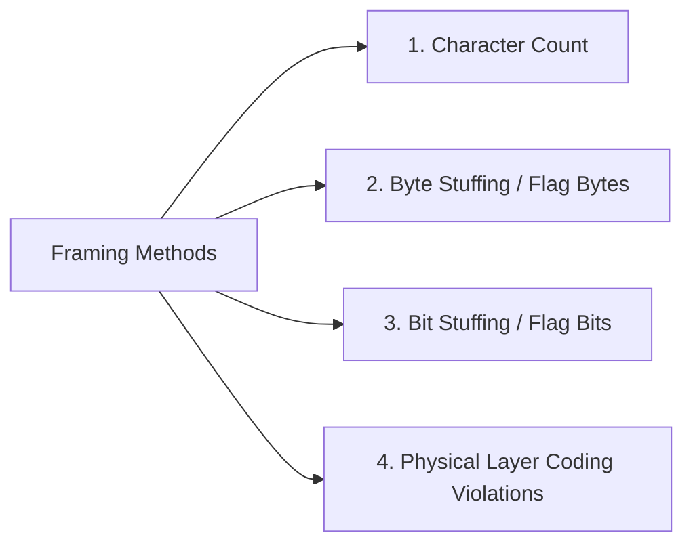

# Q1. Design Issues of the Data Link Layer and Framing Methods

> **Exam Weightage:** 5–10 Marks | **Module 2:** Data Link Layer & Network Layer

---

## 1. Overview of the Data Link Layer

The **Data Link Layer (Layer 2)** of the OSI model sits directly above the Physical Layer and below the Network Layer. Its primary responsibility is to transform the raw, unstructured bit stream offered by the Physical Layer into reliable, node-to-node (hop-to-hop) logical units called **frames**.

```
+-----------------------+
|   Network Layer (L3)  |  <-- Sends/receives Packets
+-----------------------+
            |  ^
            v  |  Service Interface
+-----------------------+
|  Data Link Layer (L2) |  <-- Framing, Error Control, Flow Control, MAC
+-----------------------+
            |  ^
            v  |  Frames <-> Raw Bits
+-----------------------+
|  Physical Layer (L1)  |  <-- Transmits raw bit stream over medium
+-----------------------+
```

---

## 2. Design Issues of the Data Link Layer

To provide reliable and efficient node-to-node communication, the Data Link Layer must address five core design issues:

### 2.1 Services Provided to the Network Layer
The Data Link Layer provides a well-defined service interface to the Network Layer. Typically, three service types are offered:
1. **Unacknowledged Connectionless Service:**
   - The source sends independent frames to the destination without establishing a logical connection and without waiting for acknowledgments (ACKs).
   - Lost or corrupted frames are not retransmitted by Layer 2 (handled by upper layers if needed).
   - *Use case:* Low-error channels (e.g., Ethernet LANs) or real-time voice/video where retransmission delay is unacceptable.
2. **Acknowledged Connectionless Service:**
   - No logical connection is established beforehand, but each transmitted frame is individually acknowledged.
   - If an ACK is not received within a timeout interval, the frame is retransmitted.
   - *Use case:* Unreliable wireless channels (e.g., IEEE 802.11 Wi-Fi).
3. **Acknowledged Connection-Oriented Service:**
   - A logical connection is established before data transfer, frames are numbered and guaranteed to arrive in exact order, and the connection is released afterward.
   - *Use case:* Long, unreliable WAN links (e.g., satellite links).

### 2.2 Framing
- The Physical Layer delivers a continuous stream of raw bits with no inherent boundaries.
- **Framing** breaks this bit stream into discrete blocks called **frames** by adding a **header** (control info, addresses) and a **trailer** (error-checking bits such as CRC/FCS) so the receiver can accurately detect the start and end of each frame.

### 2.3 Error Control
- Physical transmission media are prone to noise, attenuation, and interference, which can flip bits (`0` $\rightarrow$ `1` or `1` $\rightarrow$ `0`) or cause entire frames to be lost.
- Error control ensures reliable delivery using:
  - **Error Detection** (Parity, Checksum, CRC) and **Error Correction** (Hamming Code).
  - **Acknowledgments (ACK / NACK):** Positive or negative feedback to the sender.
  - **Timers & Sequence Numbers:** Retransmission on timeout and duplicate detection.

### 2.4 Flow Control
- A fast sender can easily overwhelm a slow receiver whose buffer capacity is limited, causing frame drops.
- **Flow control** regulates the transmission rate so the sender does not transmit faster than the receiver can process:
  - **Feedback-based Flow Control:** The receiver sends permission/acknowledgments back to the sender (e.g., Stop-and-Wait, Sliding Window).
  - **Rate-based Flow Control:** Built-in rate limits in the protocol without explicit receiver feedback.

### 2.5 Medium Access Control (MAC)
- On shared or broadcast links (e.g., Wi-Fi, classic bus Ethernet), multiple nodes share the same physical channel.
- The **MAC sublayer** decides which station gets access to the shared medium at any given time to minimize or resolve collisions (e.g., CSMA/CD, CSMA/CA, Token Passing).

---

## 3. Framing Methods in Detail

There are **four standard framing methods** used in computer networks:



### Method 1: Character Count (Length Field)
- **Working:** A field in the frame header specifies the exact number of characters (bytes) in the frame. The receiver reads this count to know where the current frame ends and the next begins.
- **Example:**
  ```
  Frame 1 (5 bytes): [ 5 | 1 | 2 | 3 | 4 ]
  Frame 2 (5 bytes): [ 5 | 6 | 7 | 8 | 9 ]
  ```
- **Limitation:** If a transmission error corrupts the count byte itself (e.g., `5` becomes `7`), the receiver loses frame synchronization for all subsequent frames and cannot recover easily. Hence, it is rarely used alone in modern networks.

### Method 2: Flag Bytes with Byte (Character) Stuffing
- **Working:** Each frame starts and ends with a special **FLAG** byte (e.g., `01111110` or `DLE STX` / `DLE ETX`).
- **Problem:** What if the `FLAG` byte pattern appears naturally inside the payload data? The receiver would falsely detect the end of the frame.
- **Solution (Byte Stuffing):** The sender inserts a special escape byte (**ESC**) immediately before any accidental `FLAG` or `ESC` byte inside the payload. The receiver removes (unstuffs) the `ESC` byte before delivering the data to the Network Layer.
- **Example:**
  - Original Data: `A  FLAG  B  ESC  C`
  - After Byte Stuffing: `FLAG | A  ESC FLAG  B  ESC ESC  C | FLAG`
  - After Unstuffing at Receiver: `A  FLAG  B  ESC  C`
- **Limitation:** Tied to 8-bit character boundaries (not suitable for arbitrary bit-length payloads).

### Method 3: Flag Bits with Bit Stuffing
- **Working:** Frames begin and end with a unique 8-bit flag pattern: **`01111110`** (a `0`, six `1`s, and a `0`).
- **Bit Stuffing Rule (Sender):** Whenever the sender encounters **five consecutive `1`s** (`11111`) in the data stream, it automatically **stuffs a `0` bit** immediately after them—regardless of whether the next bit is `0` or `1`.
- **Bit Unstuffing Rule (Receiver):** Whenever the receiver sees five consecutive `1`s followed by a `0`, it **deletes the stuffed `0`**. If it sees five `1`s followed by another `1` (`01111110`), it recognizes the end-of-frame flag.
- **Example:**
  - Original Data: `0110111111100`
  - Stuffed Data:  `011011111`**`0`**`1100` (a `0` is inserted after five `1`s)
  - Transmitted Frame: `01111110  01101111101100  01111110`
- **Advantage:** Works for any arbitrary bit stream (used in HDLC, PPP, USB).

### Method 4: Physical Layer Coding Violations
- **Working:** Applicable only when the Physical Layer encoding contains redundancy (i.e., unused signal patterns).
- **Example (Manchester Encoding):**
  - Bit `1` = High-to-Low transition; Bit `0` = Low-to-High transition.
  - Signal levels that stay **High-High** or **Low-Low** for an entire bit period are **illegal** for data bits.
  - These illegal transitions (coding violations) are used to mark the start and end of a frame unambiguously without any stuffing overhead.
- **Advantage:** Zero bit/byte stuffing overhead; used in IEEE 802.3 (some variants) and IEEE 802.5 (Token Ring).

---

## 4. Comparison of Framing Methods

| Framing Method | Synchronization Recovery | Overhead | Dependency |
| :--- | :--- | :--- | :--- |
| **Character Count** | Poor (error in count breaks sync) | Very low (1 byte) | None |
| **Byte Stuffing** | Good | Moderate (extra `ESC` bytes) | 8-bit character size |
| **Bit Stuffing** | Good | Low (1 bit per five `1`s) | Bit-oriented (universal) |
| **Coding Violations** | Excellent | Zero | Requires redundant physical encoding |

---

## 5. References & Study Hints

- **GeeksforGeeks – Framing in Data Link Layer:** [GeeksforGeeks Framing Guide](https://vertexaisearch.cloud.google.com/grounding-api-redirect/AUZIYQHJBzoe2viz3AuUt9z2hMpIFiWXtabZM7eVHS9ak1rJ03kZSyZbO2a5O9O_8Rpp8CKbAJRrQj8QIoQneULG3mMtI_afxxRCf8G4BE8128kUhQ9acP7laIA2-isIZ6zNDbqBFLTgAtRXyMeuSVShyqHf6whFZ_MtZNSTT72Pc3Z9lZAjoPUXVQ7VdtzOo5-kzAA4)
- **GeeksforGeeks – Data Link Layer Overview:** [GeeksforGeeks DLL](https://vertexaisearch.cloud.google.com/grounding-api-redirect/AUZIYQElPR6yDLi3evT-SQw2lBJfRbvbac4ZvXaizZ5q2EzBaM54fXlpUBfOpvMLtW3ktOG-26p7b5-9V6syP5UyVhaTgUzZrBD55CyBx8vjLhERZMGkxMBwPrWsG-4qKmWWnreThS_WMJFjn4iyHbfCyoGx7qXAUvHl91u6ou6yWkCK)
- **Exam Tip:** Always draw the bit-stuffing and byte-stuffing examples clearly with stuffed bits/bytes highlighted—examiners award full marks for concrete before/after examples!
