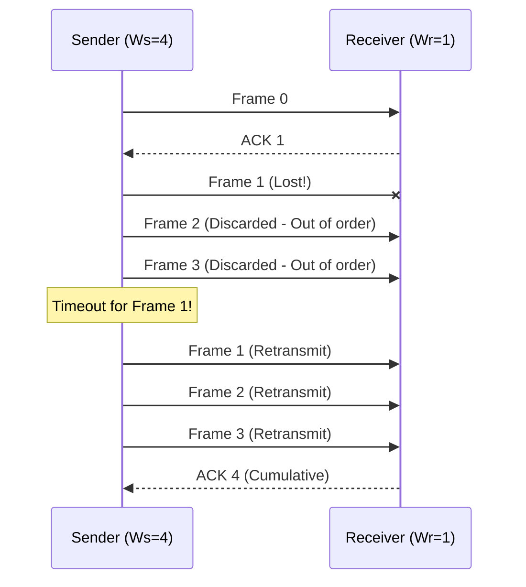
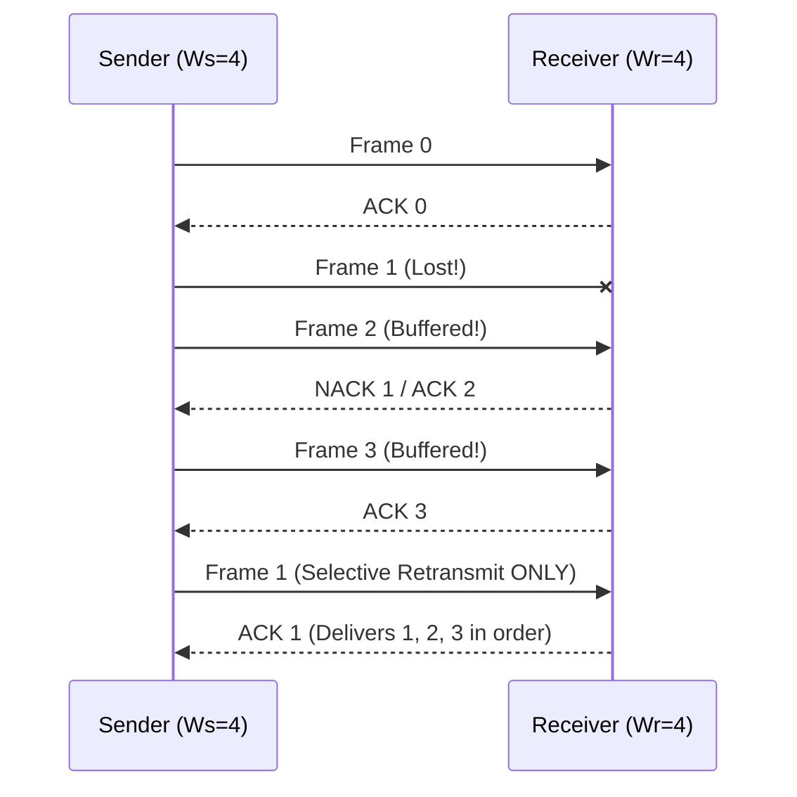

# Q7. Comparison of Go-Back-N ARQ and Selective Repeat ARQ

> **Exam Weightage:** 5–10 Marks | **Module 2:** Data Link Layer

---

## 1. Introduction to Sliding Window ARQ Protocols

Both **Go-Back-N (GBN) ARQ** and **Selective Repeat (SR) ARQ** are **Sliding Window Automatic Repeat Request (ARQ)** protocols used in the Data Link Layer for reliable, pipelined data transmission (multiple frames in flight before waiting for an ACK). They differ primarily in how they handle **lost/corrupted frames** and **out-of-order delivery**.

---

## 2. Go-Back-N (GBN) ARQ

### Working Principle
- **Sender Window Size ($W_s$):** Up to $2^k - 1$ (where $k$ is the number of sequence number bits).
- **Receiver Window Size ($W_r$):** **$1$** (the receiver only accepts the next *in-order* frame).
- **Cumulative Acknowledgment:** `ACK n` acknowledges all frames up to $n-1$ and requests frame $n$ next.
- **Error Handling:** If a frame is lost or corrupted, all subsequent frames arriving out of order are **discarded** by the receiver. When the sender's timer expires, it **"goes back"** and **retransmits the lost frame AND all subsequent frames** in the current window.

### Example Scenario (Window Size $N = 4$)
Suppose the sender transmits **Frames 0, 1, 2, 3**, and **Frame 1 is lost**:
1. Receiver gets `Frame 0` $\rightarrow$ accepts it, sends `ACK 1`.
2. `Frame 1` is lost in transit.
3. Receiver gets `Frame 2` (out of order; expected `1`) $\rightarrow$ **discards Frame 2** (sends `ACK 1` or stays silent).
4. Receiver gets `Frame 3` (out of order) $\rightarrow$ **discards Frame 3**.
5. Sender's timer for `Frame 1` expires $\rightarrow$ Sender retransmits **Frame 1, Frame 2, and Frame 3**.

---

## 3. Selective Repeat (SR) ARQ

### Working Principle
- **Sender Window Size ($W_s$):** Up to $2^{k-1}$ (half of the sequence number space, to prevent wraparound ambiguity).
- **Receiver Window Size ($W_r$):** **$2^{k-1}$** (equal to $W_s$).
- **Individual Acknowledgment:** Each correctly received frame is acknowledged individually, and **NACK** (Negative Acknowledgment) can be sent for a missing frame.
- **Error Handling:** Out-of-order frames are **accepted and buffered** by the receiver. On timeout (or NACK), the sender **retransmits ONLY the specific lost/damaged frame**. Once the missing frame arrives, the receiver reorders the buffered frames and delivers them sequentially to the Network Layer.

### Example Scenario (Window Size $N = 4$)
Suppose the sender transmits **Frames 0, 1, 2, 3**, and **Frame 1 is lost**:
1. Receiver gets `Frame 0` $\rightarrow$ accepts it, sends `ACK 0`.
2. `Frame 1` is lost in transit.
3. Receiver gets `Frame 2` $\rightarrow$ **buffers Frame 2**, sends `NACK 1` (and `ACK 2`).
4. Receiver gets `Frame 3` $\rightarrow$ **buffers Frame 3**, sends `ACK 3`.
5. Sender receives `NACK 1` (or timer expires for Frame 1) $\rightarrow$ Sender retransmits **ONLY Frame 1**.
6. Receiver gets `Frame 1` $\rightarrow$ delivers `1, 2, 3` in order to the Network Layer and sends `ACK 1`.

---

## 4. Head-to-Head Comparison Table

| Parameter | Go-Back-N (GBN) ARQ | Selective Repeat (SR) ARQ |
| :--- | :--- | :--- |
| **Sender Window Size ($W_s$)** | $2^k - 1$ | $2^{k-1}$ |
| **Receiver Window Size ($W_r$)** | **$1$** | **$2^{k-1}$** (Same as $W_s$) |
| **Out-of-Order Frames** | **Discarded** | **Accepted and Buffered** |
| **Acknowledgment Type** | Cumulative ACK | Individual ACK (+ optional NACK) |
| **Retransmission on Error** | Lost frame **+ all subsequent frames** in window | **Only the specific lost/damaged frame** |
| **Bandwidth Efficiency** | Lower (wastes bandwidth on high-error links) | **High** (minimal retransmissions) |
| **Receiver Buffer & Sorting** | Not required (simple receiver) | Required (must buffer & sort frames) |
| **Implementation Complexity** | Low | High |

---

## 5. References & Study Hints

- **GeeksforGeeks – Go-Back-N vs Selective Repeat ARQ:** [GeeksforGeeks GBN vs SR](https://vertexaisearch.cloud.google.com/grounding-api-redirect/AUZIYQEDczVZdWU4v9qBXy2UA6AxTFNpBb7aUZR3a-RQTEv7_IX9zz4MtPsM4MOOWKzsju8wTqo1STVvojmKtMNJdOC6rxUFX4iQIOwe2tjupzWoLLHztVSWUrfyzkcCJURcrdwsbyA4syqgAtK3--JyZqEnGjBiC0Glc2LOmbgC8hhc76AlyQABtEXASXF75lAp8fWtMwQ_Yy5wkELPZUV8PgMjAvajAw==)
- **GeeksforGeeks – Go-Back-N ARQ Details:** [GeeksforGeeks GBN](https://vertexaisearch.cloud.google.com/grounding-api-redirect/AUZIYQH3Wgag1ELYMBFsheOyr5Vjj9TrVGohTH2SZLiETcIcyhwTziVrN1qp1Y6mGHTbTFix4ylEGdg5MkBcO6ADNDH1HFX4UdVSIFPpHrrtudVqTNiTM3LP73TYI_bjW_LbxDp4zUBvl4bOeYLgXeE3HuFbB5q7zfIalhShMCz67vurOg1Y9yL9-zzecqpn)
- **Exam Tip:** Always include the **window size formulas** ($W_s = 2^k - 1, W_r = 1$ for GBN vs. $W_s = W_r = 2^{k-1}$ for SR) and draw the **timeline diagram** showing Frame 1 lost and Frames 2 & 3 either discarded (GBN) or buffered (SR).
