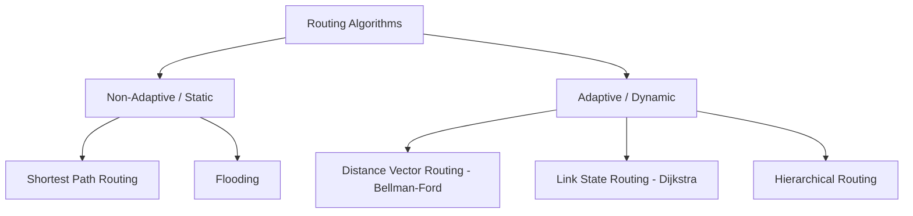

# Q12. Functions of the Network Layer and Routing Algorithms

> **Exam Weightage:** 8–10 Marks | **Module 2:** Network Layer

---

## 1. Functions of the Network Layer

The **Network Layer (Layer 3)** enables end-to-end packet delivery across interconnected networks. Its core functions are:

1. **Logical Addressing:** Assigns unique hierarchical IP addresses (IPv4/IPv6) to identify source and destination hosts across different networks.
2. **Routing:** Determines the optimal path from source to destination across multiple routers using routing tables and routing algorithms.
3. **Packet Forwarding (Switching):** Moves incoming packets from a router's input interface to the appropriate output interface based on the routing table.
4. **Internetworking:** Connects heterogeneous networks (e.g., Ethernet, Wi-Fi, fiber WANs) into a single logical network.
5. **Fragmentation & Reassembly:** Breaks oversized packets into smaller fragments when crossing links with smaller MTUs, and reassembles them at the destination.
6. **Congestion Control:** Prevents router buffer overflows and network collapse by regulating traffic (e.g., Leaky Bucket, Token Bucket, ECN).
7. **Error Reporting & Diagnostics:** Uses protocols like **ICMP** to report unreachable hosts/networks or TTL expiration.

---

## 2. Classification of Routing Algorithms

Routing algorithms are broadly divided into two categories:

### 2.1 Non-Adaptive (Static) Routing Algorithms
Routes are computed **offline** in advance and loaded into routers; they do **not** adapt to real-time traffic or topology changes.

1. **Shortest Path Routing (Static):**
   - Represents the network as a weighted graph (nodes = routers, edges = links, weights = hops/delay/cost) and finds the shortest path using algorithms like **Dijkstra's Algorithm**.
2. **Flooding:**
   - Every incoming packet is sent out on **every outgoing link** except the one it arrived on.
   - *Control mechanism:* A **Hop Count (TTL)** is decremented at each hop to stop packets from circulating forever.
   - *Use case:* Military networks (high reliability) and broadcasting Link State Advertisements (LSAs).

### 2.2 Adaptive (Dynamic) Routing Algorithms
Routes are updated **dynamically** in response to topology changes (link failures) and traffic load.

#### A. Distance Vector Routing (DVR) — *e.g., RIP*
- **Principle:** Based on the distributed **Bellman-Ford Algorithm**. Each router maintains a table (vector) of the best-known distance to every destination and the next hop.
- **Working:** Routers periodically exchange their entire routing tables **only with immediate neighbors**.
- **Update Rule (Bellman-Ford Equation):**
  $$D_x(y) = \min_{v} \left\{ c(x, v) + D_v(y) \right\}$$
  where $c(x,v)$ is the cost to neighbor $v$, and $D_v(y)$ is $v$'s advertised distance to $y$.
- **Example:** If Router A reaches B in 2 ms, and B tells A it can reach D in 3 ms, A updates its distance to D as $2 + 3 = 5$ ms via B.
- **Limitation:** Suffers from the **Count-to-Infinity problem** (slow convergence on link failure), mitigated using *Split Horizon* and *Poison Reverse*.

#### B. Link State Routing (LSR) — *e.g., OSPF*
- **Principle:** Based on **Dijkstra's Shortest Path First (SPF)** algorithm.
- **Working (5 Steps):**
  1. Discover neighbors and their addresses.
  2. Measure delay/cost to each neighbor.
  3. Construct a **Link State Packet (LSP)** containing local link costs.
  4. **Flood** the LSP to **all routers** in the network so every router builds an identical complete topology map.
  5. Run **Dijkstra's Algorithm** locally to compute the shortest-path tree to all destinations.
- **Advantage:** Fast convergence, no Count-to-Infinity problem.

#### C. Hierarchical Routing
- **Principle:** As networks grow huge, routing tables become too large to store and exchange. Routers are grouped into **Regions / Autonomous Systems (AS)**.
- **Working:** Routers know detailed paths *within* their own region, and only need one entry per *external* region.
- **Advantage:** Dramatically reduces routing table size and update overhead (used on the global Internet via **BGP** between ASes and **OSPF/RIP** inside an AS).

---

## 3. Comparison: Distance Vector vs. Link State Routing

| Feature | Distance Vector (e.g., RIP) | Link State (e.g., OSPF) |
| :--- | :--- | :--- |
| **Algorithm** | Bellman-Ford | Dijkstra's SPF |
| **Information Shared** | Entire routing table | Only local link states (LSPs) |
| **Shared With** | Immediate neighbors only | Flooded to all routers |
| **Topology View** | Partial ("routing by rumor") | Complete network map |
| **Convergence Speed** | Slow (Count-to-Infinity risk) | Fast |
| **CPU / Memory Overhead** | Low | Higher (stores full graph) |

---

## 4. References & Study Hints

- **GeeksforGeeks – Routing Algorithms in Computer Networks:** [GeeksforGeeks Routing](https://vertexaisearch.cloud.google.com/grounding-api-redirect/AUZIYQH42QmgbkSTHVrXtgOXYmWhuVswY4RAJs7b8K7xJQZzK3hYMfItqXPWx15elxvEFmxkRhH8BMxsOFDdG2jQKQrkonvFBLROkqLgc7mgw7UiVPGjs8i7UD11OvS0D6C5qCzn8HWu8NBehR3fkIaanrqKpQcU_5e6b5EQlvsKGCI_d1f91eh3cT5zfzqHX8vo5h_iUQ==)
- **GeeksforGeeks – Distance Vector vs Link State:** [GeeksforGeeks DVR vs LSR](https://vertexaisearch.cloud.google.com/grounding-api-redirect/AUZIYQFekbd0Db2JN8X1EB5t1SMTg4tY2tjGtpFk21WiyZFEBBF37iY_NFoLtY9L1iWPyj6JbPVNsiYod76qZ3_KqwYJDf3oVzCHOZBCp2Sxzbx0-eNHxwp_7Prx2byYyKqBv_C0xdz8C_-wV1yxoCR-rxebonfFJlbg)
- **Exam Tip:** Always list the **5 steps of Link State Routing** and include the **Bellman-Ford vs. Dijkstra comparison table** to maximize marks.
