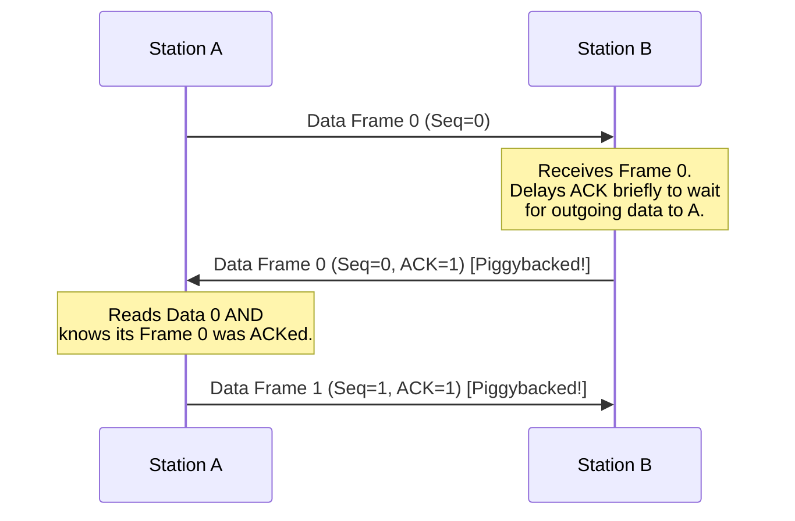

# Q6. Piggybacking in the Data Link Layer

> **Exam Weightage:** 5 Marks | **Module 2:** Data Link Layer

---

## 1. Definition

**Piggybacking** is a bandwidth-optimization technique used in **bidirectional (full-duplex)** Data Link Layer communication where a receiving node **temporarily delays sending an outgoing acknowledgment (ACK)** and **attaches ("piggybacks") it onto the header of the next outgoing data frame** destined for the same sender, rather than transmitting a separate, standalone ACK frame.

---

## 2. Why Piggybacking is Needed

In full-duplex communication, both Station A and Station B send data frames to each other simultaneously:
- **Without Piggybacking:** Every time Station B receives a data frame from A, it constructs and sends a separate ACK frame back to A. Because an ACK frame carries no payload yet still requires full framing headers, trailers, and channel access overhead, sending standalone ACKs wastes significant bandwidth and doubles frame overhead.
- **With Piggybacking:** Station B places the acknowledgment number (`ack`) in the control field of its next outgoing data frame to A, combining two transmissions into one.

---

## 3. Working of Piggybacking (Diagram)

### Step-by-Step Operation
1. Station A sends `Data Frame 0` to Station B.
2. Station B receives `Data Frame 0` correctly and needs to send `ACK 1` (expecting Frame 1 next).
3. Instead of immediately sending an empty ACK frame, Station B checks if its Network Layer has data ready to send to A.
4. When Station B sends its own `Data Frame 0` to A, it sets the `ack` field in the frame header to `1`.
5. Station A receives B's frame, extracts the data payload, and reads `ACK=1` to confirm its `Frame 0` arrived safely.

---

## 4. Handling the Waiting Problem (ACK Timer)

**Problem:** What if Station B has **no data to send** to Station A for a long time?
- If B waits indefinitely for outgoing data, A's **retransmission timer** will expire, causing A to assume its frame was lost and unnecessarily retransmit it.

**Solution (Acknowledgment Timer):**
- Station B starts a short **ACK waiting timer** upon receiving a data frame:
  - **Case 1:** If outgoing data arrives from the Network Layer *before* the timer expires $\rightarrow$ **Piggyback the ACK** onto the data frame.
  - **Case 2:** If the timer expires *before* any outgoing data arrives $\rightarrow$ **Send a standalone ACK frame** immediately.

---

## 5. Advantages & Disadvantages

### Advantages
1. **Better Bandwidth Utilization:** Eliminates separate empty ACK frames, saving channel capacity.
2. **Reduced Protocol Overhead:** Fewer total frames mean fewer headers, trailers, and medium-access contentions.
3. **Lower CPU/Processing Load:** Both stations process fewer individual frames.

### Disadvantages
1. **Added Complexity:** Requires an extra ACK waiting timer and coordination logic at the Data Link Layer.
2. **Slight Delay in ACKs:** If data traffic is asymmetric (mostly one-way), waiting for the ACK timer adds minor latency.

---

## 6. References & Study Hints

- **TutorialsPoint – Piggybacking in Computer Networks:** [TutorialsPoint Piggybacking](https://vertexaisearch.cloud.google.com/grounding-api-redirect/AUZIYQEyU_Ow7XIjrWtxFMVxJrGumsxUQpO7Y67CjmJSle3NC-VfsvHuYQx3JDoiIKbOXcI8oEI_Dy8TpK6ZVGuVXIXqwT34hJdKGF93-NrJbEIWBCkF42Gl297wYJstWeUfX1l8ItzYNnFx9mKLFuSoOLVX6XHAj6q0r2FKE60_01k=)
- **Scaler – Piggybacking Concept & Diagram:** [Scaler Piggybacking](https://vertexaisearch.cloud.google.com/grounding-api-redirect/AUZIYQFYeu6i_wyYk72huwOE6lZbaAW97LZO-QzdLeJNS2HEwRrBwFsTE3tp-2Oc0-ER7nkddRDVi8RXINCehxalbqM5EMTtjXAyl6_WgCaaRXAt6mZP3At8JxO3HlM-YuUxWZzWdq2e7jqRAGD7r3-1Af4wwlcGDSY=)
- **Exam Tip:** Always mention the **ACK waiting timer** (what happens when the receiver has no data to send)—this is the #1 follow-up point examiners look for in 5-mark answers.
