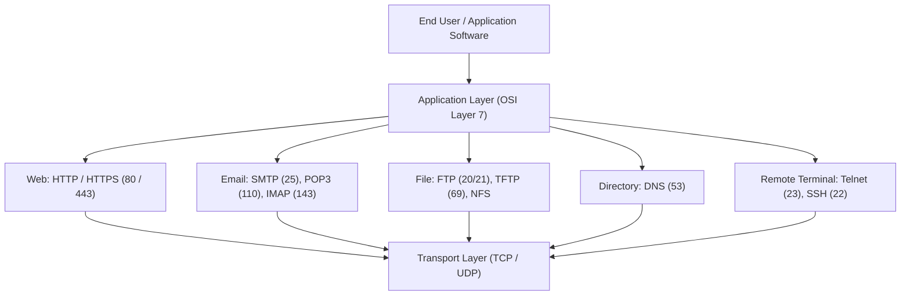

# 10. Functions and Design Issues of the Application Layer

## Introduction

The **Application Layer** is the topmost layer in both the **OSI Model (Layer 7)** and the **TCP/IP Model (Layer 4/5)**. It serves as the direct interface between user-facing software applications (web browsers, email clients, file transfer tools) and the underlying network stack. Unlike lower layers that focus on moving bits, frames, packets, or segments, the Application Layer defines **how application processes communicate** and provides high-level network services to end users.

---

## 1. Key Functions of the Application Layer

1. **Network Virtual Terminal (NVT):**
   * Enables remote login to heterogeneous hosts by mapping local terminal keystrokes and display codes into a universal virtual terminal format.
   * *Protocols:* **Telnet**, **SSH**.
2. **File Transfer, Access, and Management (FTAM):**
   * Allows users to transfer files between hosts, access remote file systems, and manage directories/permissions across different operating systems.
   * *Protocols:* **FTP**, **SFTP**, **TFTP**, **NFS**, **SMB**.
3. **Electronic Mail Services:**
   * Provides store-and-forward email delivery, routing, and mailbox retrieval.
   * *Protocols:* **SMTP** (sending), **POP3** & **IMAP** (receiving).
4. **Directory & Name Resolution Services:**
   * Maintains distributed databases to map human-readable names to network addresses or locate resources.
   * *Protocols:* **DNS** (Domain Name System), **LDAP**.
5. **World Wide Web (Web Access):**
   * Facilitates requesting, formatting, and transferring hypermedia documents (HTML, JSON, images, video) between browsers and web servers.
   * *Protocols:* **HTTP**, **HTTPS**.
6. **Network Management:**
   * Monitors and configures network devices (routers, switches, servers) remotely.
   * *Protocol:* **SNMP** (Simple Network Management Protocol).
7. **Host Configuration:**
   * Dynamically assigns IP addresses and network parameters to hosts.
   * *Protocol:* **DHCP** (Dynamic Host Configuration Protocol).

---

## 2. Design Issues of the Application Layer

Designing application-layer protocols and distributed systems involves addressing several architectural and operational challenges:

### A. Choice of Application Architecture Paradigm
* **Client–Server Model:** An always-on centralized **server** listens for requests from **clients** (e.g., HTTP, DNS, FTP).
  * *Design Issue:* Scalability bottlenecks, load balancing, and avoiding single points of failure.
* **Peer-to-Peer (P2P) Model:** Peers communicate directly without relying heavily on central servers (e.g., BitTorrent).
  * *Design Issue:* Peer discovery, churn (peers joining/leaving unpredictably), and decentralized security.

### B. Transport Protocol Selection (TCP vs. UDP)
* Designers must match application requirements to underlying transport services:
  * **TCP:** Chosen when 100% reliability and ordered delivery are mandatory (e.g., HTTP, FTP, SMTP).
  * **UDP:** Chosen when low latency is prioritized over reliability (e.g., DNS queries, VoIP, live streaming), requiring the application itself to handle timeouts or packet loss if needed.

### C. Data Representation and Interoperability
* Heterogeneous systems may use different character encodings (ASCII vs. EBCDIC), line endings (`CRLF` vs. `LF`), or byte ordering (big-endian vs. little-endian).
* *Solution:* Standardize message formats using text-based headers and structured encodings such as **JSON**, **XML**, **MIME**, or **Protocol Buffers**.

### D. Security, Privacy, and Authentication
* Because the Application Layer is closest to users and sensitive data, it is a prime target for attacks (SQL injection, XSS, phishing, credential sniffing).
* *Solution:* Integrate **TLS/SSL** (HTTPS), strong authentication (**OAuth**, **JWT**, **SSH keys**), and input validation.

### E. State Management vs. Statelessness
* Protocols like HTTP are **stateless** by design (each request is independent) to improve scalability. However, applications (e-commerce carts, logins) need state.
* *Solution:* Maintain application state using **Cookies**, **Sessions**, or **Tokens** without overloading server memory.

### F. Extensibility, Caching, and Scalability
* Protocols must evolve without breaking older clients (e.g., HTTP/1.1 $\rightarrow$ HTTP/2 $\rightarrow$ HTTP/3) and support caching headers, CDNs, and compression to handle global Internet scale.

---

## Architecture Diagram: Application Layer Services & Protocols

---

## References & Study Hints

* **TutorialsPoint — Application Layer Introduction:** [https://www.tutorialspoint.com/data_communication_computer_network/application_layer_introduction.htm](https://www.tutorialspoint.com/data_communication_computer_network/application_layer_introduction.htm)
* **GeeksforGeeks — Application Layer Protocols in TCP/IP:** [https://www.geeksforgeeks.org/computer-networks/application-layer-protocols-in-tcp-ip/](https://www.geeksforgeeks.org/computer-networks/application-layer-protocols-in-tcp-ip/)
* **Exam Tip (5–10 Marks):** Split your answer cleanly into two halves: **Functions** (with protocol examples and port numbers) and **Design Issues** (Client-Server vs. P2P, TCP vs. UDP choice, Interoperability, Security, State Management, Scalability).
