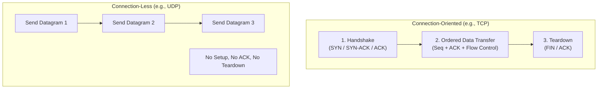

# 3. Connection-Oriented vs. Connection-Less Protocols

## Introduction

In computer networks, communication protocols at the Transport Layer (and Network Layer) are broadly classified into **Connection-Oriented** and **Connection-Less** protocols depending on whether a logical session is established prior to data transfer.

---

## 1. Connection-Oriented Protocol

A **connection-oriented protocol** requires a dedicated logical connection (session) to be established between the sender and receiver **before** any application data is transmitted.

* **Analogy:** **Making a telephone call.** You dial the number, wait for the other person to answer (connection establishment), hold a conversation (data transfer), and say goodbye/hang up (connection termination).
* **Phases:**
  1. **Connection Establishment:** Handshaking (e.g., TCP's 3-Way Handshake) allocates buffers and synchronizes sequence numbers.
  2. **Data Transfer:** Data segments are sent sequentially, acknowledged, and retransmitted if lost.
  3. **Connection Termination:** Explicit teardown (e.g., TCP's 4-way `FIN` handshake) frees resources.
* **Key Characteristics:**
  * **High Reliability:** Guarantees delivery without loss, corruption, or duplication.
  * **In-Order Delivery:** Segments are reassembled in the exact order sent.
  * **Higher Overhead:** Requires handshaking, state tracking, acknowledgments, and larger headers.
* **Examples:** **TCP** (Transmission Control Protocol), **HTTP/HTTPS**, **FTP**, **SSH**, **SMTP**.

---

## 2. Connection-Less Protocol

A **connection-less protocol** transmits each packet (called a **datagram**) independently from sender to receiver **without** establishing any prior connection or maintaining session state.

* **Analogy:** **Sending postal letters.** You write the full destination address on each envelope and drop them into the mailbox. Letters may travel along different routes, arrive out of order, or even get lost without notice.
* **Key Characteristics:**
  * **No Handshake:** Data transmission begins immediately with zero setup delay.
  * **Unreliable ("Best-Effort"):** No acknowledgments, retransmissions, or guaranteed delivery.
  * **Out-of-Order Delivery:** Each datagram is routed independently and may arrive out of sequence.
  * **Low Overhead & High Speed:** Minimal header size (e.g., 8 bytes in UDP) and no connection state tracking.
  * **Supports Broadcasting & Multicasting:** One packet can be sent to many receivers simultaneously.
* **Examples:** **UDP** (User Datagram Protocol), **IP** (Internet Protocol), **ICMP**, **DNS** (queries), **DHCP**.

---

## 3. Conceptual Flow Diagram

---

## 4. Detailed Comparison Table

| Parameter | Connection-Oriented Protocol | Connection-Less Protocol |
| :--- | :--- | :--- |
| **Connection Setup** | Mandatory handshake before data transfer | No connection setup; data sent immediately |
| **Reliability** | Reliable (guarantees delivery via ACKs & retransmission) | Unreliable (best-effort; lost packets are not resent) |
| **Packet Ordering** | Guaranteed in-order delivery | No ordering guarantee; packets may arrive out of order |
| **Header Overhead** | High (e.g., TCP: 20–60 bytes) | Low (e.g., UDP: fixed 8 bytes) |
| **Speed & Latency** | Slower due to handshake and control overhead | Faster with minimal latency |
| **Packet Routing** | Logical stream / virtual circuit behavior | Each packet routed independently |
| **Flow & Congestion Control** | Built-in (e.g., Sliding Window, AIMD) | None at transport layer |
| **Communication Mode** | Unicast (point-to-point) only | Supports Unicast, Multicast, and Broadcast |
| **Resource Usage** | High (maintains connection state tables & buffers) | Low (stateless) |
| **Use Cases** | Web browsing (HTTP), File transfer (FTP), Email (SMTP) | Video/Audio streaming, VoIP, Online gaming, DNS |
| **Protocol Examples** | **TCP**, SCTP | **UDP**, IP, ICMP |

---

## References & Study Hints

* **GeeksforGeeks — Connection-Oriented vs. Connection-Less Services:** [https://www.geeksforgeeks.org/computer-networks/difference-between-connection-oriented-and-connection-less-services/](https://www.geeksforgeeks.org/computer-networks/difference-between-connection-oriented-and-connection-less-services/)
* **TutorialsPoint — Connection-Oriented vs. Connection-Less:** [https://www.tutorialspoint.com/article/difference-between-connection-oriented-and-connection-less-services](https://www.tutorialspoint.com/article/difference-between-connection-oriented-and-connection-less-services)
* **YouTube Lecture (Neso Academy / Networking):** [https://www.youtube.com/watch?v=EhVgiPLjw0A](https://www.youtube.com/watch?v=EhVgiPLjw0A)
* **Exam Tip (5–10 Marks):** Start with clear definitions and real-world analogies (telephone vs. postal mail), then present a 8–10 row comparison table with concrete protocol examples (**TCP** vs. **UDP**).
