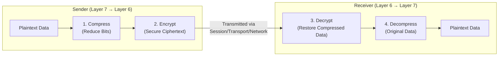

# 7. Significance of Data Compression and Encryption in the Presentation Layer

## Introduction

The **Presentation Layer** (Layer 6 of the OSI Reference Model) acts as the **translation, formatting, and security layer** between the Application Layer (Layer 7) and the Session Layer (Layer 5). Its primary goal is to ensure that data sent by an application on one machine can be **understood, efficiently transmitted, and securely protected** when received by an application on a heterogeneous machine.

Alongside **data translation** (e.g., ASCII to EBCDIC, UTF-8, byte-ordering/endianness), the two most significant functions of the Presentation Layer are **Data Compression** and **Data Encryption**.

---

## 1. Data Compression in the Presentation Layer

**Data Compression** is the process of encoding information using fewer bits than its original representation before transmission, and reconstructing it at the receiver.

### How It Works
* **At Sender:** Layer 6 applies a compression algorithm to reduce the size of the outgoing data stream before passing it down to the Session Layer.
* **At Receiver:** Layer 6 applies the corresponding decompression algorithm to restore the data for the Application Layer.

### Types of Data Compression
1. **Lossless Compression:**
   * Reconstructs the **exact bit-for-bit original data** upon decompression.
   * *Algorithms/Formats:* Run-Length Encoding (RLE), Huffman Coding, Lempel-Ziv-Welch (LZW), ZIP, GZIP, PNG.
   * *Use Cases:* Text files, source code, executables, financial records.
2. **Lossy Compression:**
   * Permanently discards less perceptible or redundant details to achieve **much higher compression ratios**.
   * *Algorithms/Formats:* JPEG (images), MP3/AAC (audio), MPEG/H.264 (video).
   * *Use Cases:* Multimedia streaming, images, voice/video calls.

### Significance of Data Compression
* **Saves Network Bandwidth:** Fewer bits transmitted means lower bandwidth consumption across WANs and congested links.
* **Reduces Transmission Latency:** Smaller payloads transfer faster, improving application responsiveness.
* **Lowers Storage & Cost:** Reduces data volume for metered/mobile connections and cloud storage.

---

## 2. Data Encryption and Decryption in the Presentation Layer

**Data Encryption** is the process of transforming readable **plaintext** into an unreadable scrambled form (**ciphertext**) using a cryptographic algorithm and key, ensuring confidentiality over untrusted networks.

### How It Works
* **Encryption (Sender):** Layer 6 converts plaintext into ciphertext before transmission.
* **Decryption (Receiver):** Layer 6 uses the appropriate key to convert ciphertext back into readable plaintext.

### Types of Encryption
1. **Symmetric-Key Encryption:** Uses the **same shared secret key** for both encryption and decryption (e.g., **AES**, **DES**, **ChaCha20**). Fast and ideal for bulk data.
2. **Asymmetric-Key (Public-Key) Encryption:** Uses a **public key** for encryption and a mathematically linked **private key** for decryption (e.g., **RSA**, **ECC**). Used for key exchange and digital signatures.
* *(Real-world protocols like **SSL/TLS** operate at the boundary of Presentation/Session/Application layers to secure HTTP $\rightarrow$ HTTPS.)*

### Significance of Data Encryption
* **Confidentiality (Privacy):** Protects sensitive data (passwords, credit cards, personal records) from eavesdropping and packet sniffing.
* **Data Integrity & Authentication:** Combined with cryptographic hashes/MACs and digital certificates, ensures data has not been tampered with in transit and verifies the sender's identity.
* **Regulatory Compliance:** Meets legal and industry standards (GDPR, HIPAA, PCI-DSS) for transmitting sensitive information.

---

## Combined Workflow: Sender to Receiver (Order of Operations)

> **Important Rule:** Data is **compressed first, then encrypted** at the sender (and **decrypted first, then decompressed** at the receiver). Encrypted data appears random and cannot be effectively compressed!

---

## References & Study Hints

* **GeeksforGeeks — Presentation Layer Services:** [https://www.geeksforgeeks.org/computer-networks/presentation-layer-services/](https://www.geeksforgeeks.org/computer-networks/presentation-layer-services/)
* **TutorialsPoint — Presentation Layer:** [https://www.tutorialspoint.com/data_communication_computer_network/presentation_layer.htm](https://www.tutorialspoint.com/data_communication_computer_network/presentation_layer.htm)
* **Exam Tip (5–10 Marks):** Clearly define Layer 6's role, explain **Lossless vs. Lossy compression** with examples, explain **Symmetric vs. Asymmetric encryption**, and highlight the golden rule: **Compress first, then Encrypt**.
