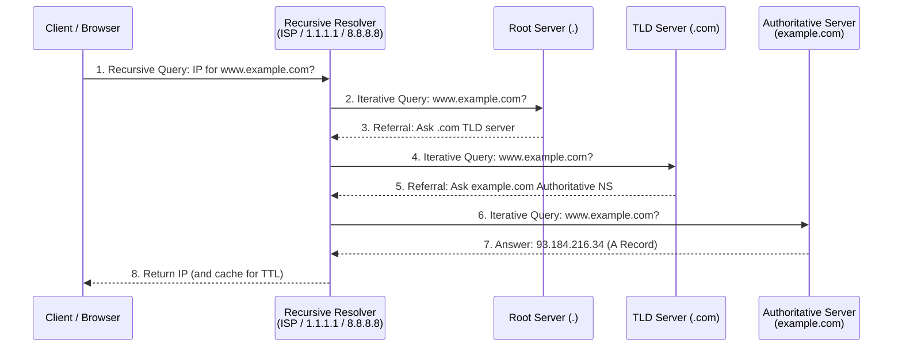

# 15. Domain Name System (DNS) and Its Hierarchical Structure

## Introduction

The **Domain Name System (DNS)**—standardized in **RFC 1034 / 1035**—is a distributed, hierarchical naming and directory database for the Internet (operating on **UDP/TCP Port 53**). Its primary function is to translate human-readable domain names (e.g., `www.example.com`) into machine-routable numerical IP addresses (e.g., `93.184.216.34` or IPv6 addresses).

### Why DNS Is Required
* Humans easily remember meaningful names, whereas routers and IP networks require numeric IP addresses.
* A single centralized host file (like the early `HOSTS.TXT`) cannot scale to billions of Internet hosts.
* DNS allows a server's IP address to change transparently without changing its public domain name.

---

## 1. Hierarchical Structure of DNS

DNS is organized as an **inverted tree** of domain name space, divided into levels from top (Root) to bottom (Hosts):

```text
                        [ Root Domain ( . ) ]
                                  |
            +---------------------+---------------------+
            |                     |                     |
         [.com]                [.org]                [.edu]     <-- Top-Level Domains (TLDs)
            |                     |                     |
        [google]             [wikipedia]              [mit]     <-- Second-Level Domains (SLDs)
            |                     |
      +-----+-----+            [en]                             <-- Subdomains
      |           |
    [www]      [mail]                                           <-- Hostnames (Leaf Nodes)
```

### Levels of the DNS Hierarchy
1. **Root Level (`.`):**
   * The apex of the DNS tree.
   * Managed globally by **13 logical Root Name Server clusters** (`A` through `M`, replicated worldwide via Anycast).
   * Root servers do not store individual domain IPs; they refer queries to the appropriate **TLD servers**.
2. **Top-Level Domains (TLDs):**
   * The rightmost label of a domain name, divided into:
     * **Generic TLDs (gTLDs):** `.com`, `.org`, `.net`, `.edu`, `.gov`.
     * **Country-Code TLDs (ccTLDs):** `.in`, `.uk`, `.us`, `.jp`, `.de`.
   * TLD servers point resolvers to the **Authoritative Name Server** for a given domain.
3. **Second-Level Domains (SLDs):**
   * Registered by organizations or individuals under a TLD (e.g., `google` in `google.com`, `wikipedia` in `wikipedia.org`).
4. **Subdomains & Leaf Hosts:**
   * Organizations can subdivide their domain into subdomains (e.g., `mail.google.com`, `cs.mit.edu`).
   * A **Fully Qualified Domain Name (FQDN)** ends with the root dot (e.g., `www.google.com.`).

---

## 2. How DNS Resolution Works (Recursive vs. Iterative Lookup)

When a user enters `www.example.com` in a browser:



---

## 3. Common DNS Resource Records

| Record Type | Purpose |
| :--- | :--- |
| **`A`** | Maps a hostname to an **IPv4** address (32-bit). |
| **`AAAA`** | Maps a hostname to an **IPv6** address (128-bit). |
| **`CNAME`** | Canonical Name; creates an alias from one domain name to another. |
| **`MX`** | Mail Exchange; specifies the mail server(s) responsible for accepting email for the domain. |
| **`NS`** | Name Server; identifies the authoritative DNS servers for a domain/zone. |
| **`PTR`** | Pointer record; used for **Reverse DNS** lookups (IP $\rightarrow$ hostname). |

---

## References & Study Hints

* **GeeksforGeeks — Details on DNS:** [https://www.geeksforgeeks.org/computer-networks/details-on-dns/](https://www.geeksforgeeks.org/computer-networks/details-on-dns/)
* **TutorialsPoint — What is a Domain Name System:** [https://www.tutorialspoint.com/article/what-is-a-domain-name-system](https://www.tutorialspoint.com/article/what-is-a-domain-name-system)
* **Exam Tip (5–10 Marks):** Draw the **inverted tree hierarchy** (Root $\rightarrow$ TLD $\rightarrow$ SLD $\rightarrow$ Subdomain), trace the **8-step DNS resolution flow** (Recursive vs. Iterative queries), and list key DNS record types (`A`, `AAAA`, `CNAME`, `MX`, `NS`).
