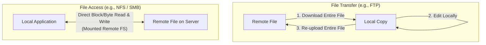

# 12. File Transfer and File Access Mechanisms

## Introduction

In distributed computer networks, users and applications frequently need to share, move, and edit files stored on remote machines. These operations are handled at the Application Layer through two distinct paradigms: **File Transfer Mechanisms** and **File Access Mechanisms**.

---

## 1. File Transfer vs. File Access Mechanisms

| Aspect | File Transfer Mechanism | File Access Mechanism (Remote File System) |
| :--- | :--- | :--- |
| **Core Concept** | Copies the **entire file** from a remote server to the local machine (or vice versa) before reading/editing. | Allows direct **read, write, and seek** operations on specific parts of a remote file over the network without downloading the whole file. |
| **Transparency** | User explicitly issues transfer commands (`get`, `put`). | **Transparent** to applications; remote directories are *mounted* so they behave like local storage. |
| **Synchronization** | Local edits are not reflected on the server until re-uploaded. | Changes happen directly on the server (managed via locking/caching). |
| **Examples** | **FTP**, **TFTP**, **SFTP**, **SCP** | **NFS** (UNIX/Linux), **SMB/CIFS** (Windows/Samba), **FTAM** (OSI) |

---

## 2. Major File Transfer Protocols

* **FTP (File Transfer Protocol):** Uses TCP ports 21 (Control) and 20 (Data) for reliable, authenticated bulk file transfers.
* **TFTP (Trivial File Transfer Protocol):** Minimalist UDP-based protocol (Port 69) with no authentication; used for booting diskless workstations (PXE) and transferring router firmware.
* **SFTP / FTPS:** Secure encrypted alternatives using SSH (Port 22) or SSL/TLS.

---

## 3. Major File Access Mechanisms

### A. FTAM (File Transfer, Access, and Management)
* **Standard:** Defined under the **OSI Reference Model** (ISO 8571).
* **Virtual File Store (VFS):** FTAM abstracts diverse OS file formats into a universal **Virtual File Store**, allowing heterogeneous systems to transfer entire files, access individual records/nodes inside structured files, and manage file attributes/permissions.
* **Status:** Largely superseded in practice by TCP/IP protocols (FTP, NFS, SMB), though foundational in networking theory.

### B. NFS (Network File System)
* **Origin:** Developed by Sun Microsystems; standard in **UNIX/Linux** environments.
* **Working:**
  * The server **exports** directories; the client **mounts** them into its local directory tree.
  * Built on **RPC (Remote Procedure Calls)** and **XDR (External Data Representation)** over TCP/UDP (Port 2049).
  * Uses opaque **File Handles** so clients can read/write remote file blocks transparently.

### C. SMB / CIFS (Server Message Block)
* **Origin:** Primarily used in **Windows** LANs (and Linux/macOS via **Samba**).
* **Working:**
  * A stateful request–response application-layer protocol running over **TCP Port 445**.
  * Enables transparent **file sharing, printer sharing**, and inter-process communication across local networks, supporting file locking, opportunistic caching, and SMB 3.0 encryption.

---

## References & Study Hints

* **GeeksforGeeks — File Sharing in OS / Remote File Systems:** [https://www.geeksforgeeks.org/operating-systems/file-sharing-in-os/](https://www.geeksforgeeks.org/operating-systems/file-sharing-in-os/)
* **GeeksforGeeks — Introduction to Microsoft SMB:** [https://www.geeksforgeeks.org/computer-networks/introduction-to-microsoft-smb-a-network-file-sharing-protocol/](https://www.geeksforgeeks.org/computer-networks/introduction-to-microsoft-smb-a-network-file-sharing-protocol/)
* **Exam Tip (5–10 Marks):** Clearly contrast **File Transfer** (whole-file copy: FTP, TFTP) with **File Access** (transparent mounted access: NFS, SMB, FTAM), and briefly explain how **NFS (RPC + Mount)**, **SMB (TCP 445)**, and **FTAM (Virtual File Store)** work.
