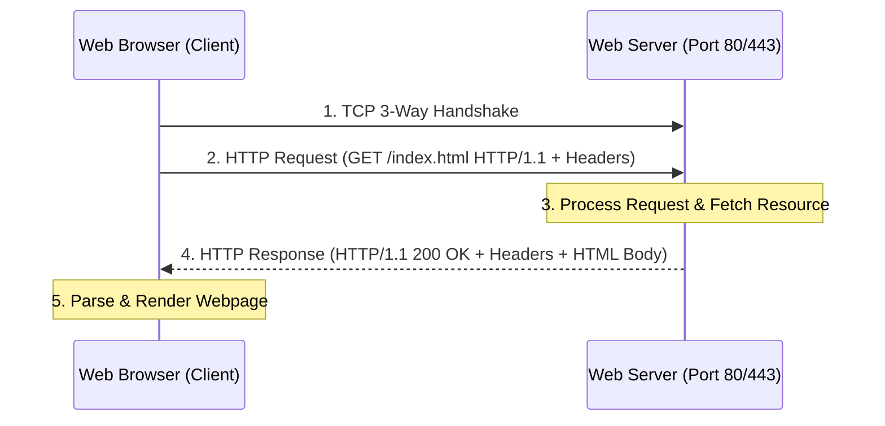

# 16. Working of HTTP Protocol and Its Message Format

## Introduction

**HTTP (Hypertext Transfer Protocol)** is a **stateless, text-based, application-layer request–response protocol** (operating on **TCP Port 80**; **HTTPS** uses TLS encryption on **TCP Port 443**). It is the foundational data-communication protocol of the **World Wide Web (WWW)**, used by web browsers (clients) to fetch HTML pages, images, stylesheets, scripts, and JSON/XML API data from web servers.

### Key Characteristics of HTTP
* **Client–Server:** Clients initiate requests; servers return responses.
* **Stateless:** Each request–response pair is independent; the server retains no memory of prior requests unless state is added via **Cookies**, **Sessions**, or **Tokens**.
* **Connection Modes:** **Non-persistent** (one TCP connection per object in HTTP/1.0) vs. **Persistent (`keep-alive`)** (reuses one TCP connection in HTTP/1.1), **Multiplexed Streams** (HTTP/2), and **QUIC/UDP** (HTTP/3).

---

## 1. Working of HTTP (Request–Response Cycle)

1. **URL Entry:** User enters `http://www.example.com/index.html` in the browser.
2. **DNS Resolution:** Browser resolves `www.example.com` to the server's IP address via DNS.
3. **TCP Connection:** Browser establishes a TCP connection with the server on Port 80 (or 443 + TLS handshake for HTTPS) using a 3-way handshake.
4. **HTTP Request:** Browser sends an HTTP Request message (e.g., `GET /index.html HTTP/1.1`).
5. **Server Processing:** Web server locates or dynamically generates the requested resource.
6. **HTTP Response:** Server sends back an HTTP Response message containing a status code (e.g., `200 OK`), headers, and the HTML payload.
7. **Rendering:** Browser parses the HTML and renders the webpage (making additional HTTP requests for embedded CSS, JS, and images).



---

## 2. HTTP Message Format

Both HTTP Request and Response messages share a clean 4-part structure:
1. **Start Line** (Request Line or Status Line)
2. **Header Fields** (`Key: Value` pairs)
3. **Blank Line** (`CRLF` — separates headers from body)
4. **Optional Message Body** (Payload)

### A. HTTP Request Message Format

```text
+-------------------------------------------------------+
|  Method   |  SP  |  Request-URI  |  SP  | HTTP-Version|  <- Request Line
+-------------------------------------------------------+
|  Header-Name-1: Header-Value-1                        |
|  Header-Name-2: Header-Value-2                        |  <- Request Headers
+-------------------------------------------------------+
|  (Blank Line / CRLF)                                  |
+-------------------------------------------------------+
|  Optional Request Body (e.g., JSON / Form Data)       |  <- Entity Body
+-------------------------------------------------------+
```

**Example Request:**
```http
POST /api/login HTTP/1.1
Host: www.example.com
User-Agent: Mozilla/5.0
Content-Type: application/json
Content-Length: 36

{"user": "alice", "pass": "secret"}
```

* **Common HTTP Methods:**
  * `GET` — Retrieve a resource (no body).
  * `POST` — Submit data to create/process a resource.
  * `PUT` — Replace/update an existing resource.
  * `DELETE` — Remove a resource.
  * `HEAD` — Retrieve headers only (no body).

---

### B. HTTP Response Message Format

```text
+-------------------------------------------------------+
| HTTP-Version | SP | Status-Code | SP | Reason-Phrase  |  <- Status Line
+-------------------------------------------------------+
|  Header-Name-1: Header-Value-1                        |
|  Header-Name-2: Header-Value-2                        |  <- Response Headers
+-------------------------------------------------------+
|  (Blank Line / CRLF)                                  |
+-------------------------------------------------------+
|  Optional Response Body (HTML, JSON, Image, etc.)     |  <- Entity Body
+-------------------------------------------------------+
```

**Example Response:**
```http
HTTP/1.1 200 OK
Date: Wed, 25 Nov 2026 12:00:00 GMT
Content-Type: text/html; charset=UTF-8
Content-Length: 48

<html><body><h1>Hello, World!</h1></body></html>
```

* **HTTP Status Code Categories:**
  * **`1xx` (Informational):** Request received, continuing process (e.g., `100 Continue`).
  * **`2xx` (Success):** Action succeeded (e.g., `200 OK`, `201 Created`).
  * **`3xx` (Redirection):** Further action needed (e.g., `301 Moved Permanently`, `304 Not Modified`).
  * **`4xx` (Client Error):** Bad syntax or unauthorized (e.g., `400 Bad Request`, `403 Forbidden`, `404 Not Found`).
  * **`5xx` (Server Error):** Server failed to fulfill valid request (e.g., `500 Internal Server Error`, `502 Bad Gateway`).

---

## References & Study Hints

* **MDN Web Docs — HTTP Overview:** [https://developer.mozilla.org/en-US/docs/Web/HTTP](https://developer.mozilla.org/en-US/docs/Web/HTTP)
* **GeeksforGeeks — What is HTTP:** [https://www.geeksforgeeks.org/html/what-is-http/](https://www.geeksforgeeks.org/html/what-is-http/)
* **Exam Tip (5–10 Marks):** Highlight that HTTP is **stateless** and uses **TCP Port 80 (443 for HTTPS)**, draw both **Request** and **Response** message format boxes with concrete examples, and list the main **HTTP Methods** and **Status Code classes (`1xx`–`5xx`)**.
