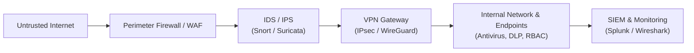

# 8. Computer Network Security and Privacy: Importance, Functions, Tools, and Software

## Introduction

* **Computer Network Security** comprises the policies, practices, and technologies designed to prevent, detect, and respond to unauthorized access, misuse, modification, or denial of network resources.
* **Network Privacy** focuses on protecting individuals' and organizations' sensitive, personal, or proprietary data from unauthorized observation, collection, or disclosure.

---

## 1. Importance of Network Security and Privacy

1. **Preventing Data Breaches & Financial Loss:** Protects intellectual property, banking credentials, and customer records from theft or ransomware extortion.
2. **Defending Against Cyber Threats:** Mitigates malware, phishing, Denial-of-Service (DoS/DDoS), and Man-in-the-Middle (MitM) attacks.
3. **Ensuring Business Continuity:** Prevents costly network downtime and keeps critical services available.
4. **Regulatory & Legal Compliance:** Helps organizations comply with data protection laws such as **GDPR**, **HIPAA**, and **PCI-DSS**.
5. **Maintaining User Trust:** Builds confidence among customers and partners that their digital communications are confidential.

---

## 2. Core Security Functions (The CIA Triad + AAA)

Network security functions are built around the **CIA Triad** and **AAA** framework:

| Function | Description | Primary Mechanisms |
| :--- | :--- | :--- |
| **Confidentiality** | Ensures sensitive data is accessible only to authorized parties. | Encryption (AES, RSA, TLS/SSL), VPNs, Access Controls |
| **Integrity** | Guarantees data is accurate and unaltered during transit or storage. | Cryptographic Hashing (SHA-256), HMAC, Digital Signatures |
| **Availability** | Ensures network resources remain accessible to authorized users when needed. | Firewalls, DDoS Mitigation, Redundancy, Load Balancing |
| **Authentication** | Verifies the identity of users, devices, or services. | Passwords, Multi-Factor Authentication (MFA), X.509 Certificates |
| **Authorization & Accounting** | Determines what an authenticated user can access and logs all actions. | Role-Based Access Control (RBAC), Audit Logs, SIEM |

---

## 3. Defense-in-Depth Architecture Diagram

---

## 4. Essential Network Security Tools and Software

### A. Boundary & Traffic Filtering Tools
* **Firewalls (Hardware/Software/NGFW):** Filter incoming and outgoing packets based on IP, port, state, and application rules (e.g., pfSense, Windows Defender Firewall, Palo Alto NGFW).
* **Web Application Firewalls (WAF):** Protect web apps against SQL Injection, XSS, and OWASP Top 10 attacks (e.g., Cloudflare WAF, ModSecurity).

### B. Intrusion Detection and Monitoring Tools
* **Snort / Suricata (IDS/IPS):** Open-source Intrusion Detection and Prevention Systems that inspect traffic for malicious signatures and anomalies.
* **Wireshark:** A widely used network protocol analyzer (packet sniffer) for capturing, inspecting, and troubleshooting network traffic.
* **SIEM (Splunk / ELK Stack):** Aggregates and correlates security logs across servers and network devices to detect breaches in real time.

### C. Privacy and Secure Communication Tools
* **VPNs (OpenVPN, WireGuard, IPsec):** Create encrypted tunnels over public networks to ensure data privacy and hide user IP addresses.
* **SSL/TLS:** Cryptographic protocols securing web traffic (HTTPS), email, and APIs.
* **Data Loss Prevention (DLP):** Software that monitors and blocks unauthorized transfer of sensitive data outside the organization.

### D. Vulnerability Assessment & Penetration Testing (VAPT) Tools
* **Nmap (Network Mapper):** Scans networks to discover active hosts, open ports, and running services.
* **Nessus / OpenVAS:** Automated vulnerability scanners that detect missing patches and misconfigurations.
* **Metasploit:** A penetration testing framework used by security professionals to test and validate network defenses.

### E. Endpoint Protection
* **Antivirus / EDR (Endpoint Detection & Response):** Detects and quarantines malware, trojans, and ransomware on user devices.

---

## References & Study Hints

* **GeeksforGeeks — Computer Security Overview:** [https://www.geeksforgeeks.org/computer-science-fundamentals/computer-security-overview/](https://www.geeksforgeeks.org/computer-science-fundamentals/computer-security-overview/)
* **TutorialsPoint — Network Security Types:** [https://www.tutorialspoint.com/article/what-are-the-network-security-types](https://www.tutorialspoint.com/article/what-are-the-network-security-types)
* **Exam Tip (5–10 Marks):** Structure your answer into: (1) Importance, (2) **CIA Triad + Authentication/Integrity**, and (3) Categorized **Tools & Software** (Firewalls, IDS/IPS like Snort, Packet Analyzers like Wireshark, VPNs, Nmap/Nessus).
