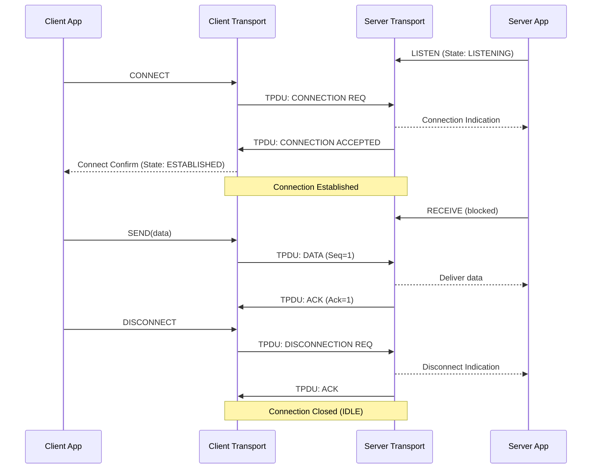

# 2. Simple Transport Protocol with an Example

## Introduction

A **Transport Protocol** provides a logical, process-to-process communication channel over an underlying network layer (such as IP). To hide the complexity of network hardware and packet routing from user applications, the transport layer exposes a clean interface of **Transport Service Primitives**.

In Andrew S. Tanenbaum's classic *Computer Networks* model, a **Simple Transport Protocol** demonstrates how a connection-oriented transport service is built using **Service Primitives**, **Transport Protocol Data Units (TPDUs)**, and a **Finite State Machine (FSM)** over an unreliable network layer.

---

## 1. Transport Service Primitives

A **primitive** is an abstract operation (function call) provided by the transport layer to the application layer. A simple connection-oriented transport protocol uses six core primitives:

| Primitive | Packet (TPDU) Sent | Meaning / Action |
| :--- | :--- | :--- |
| **`LISTEN`** | *(None)* | Server blocks and waits for an incoming connection request from a client. |
| **`CONNECT`** | `CONNECTION REQ` | Client actively initiates a connection to a waiting server. |
| **`SEND`** | `DATA` | Sends application data over an established connection. |
| **`RECEIVE`** | *(None)* | Blocks/waits until a `DATA` TPDU arrives from the peer. |
| **`DISCONNECT`** | `DISCONNECTION REQ` | Gracefully closes an existing connection. |
| **`ACCEPT`** | *(Internal/Reply)* | Server accepts an incoming connection indication (used in socket APIs). |

### Four Classes of Service Primitives
Interactions between the Application Layer and Transport Layer follow a structured cycle:
1. **Request:** Application asks the transport layer to perform an action (e.g., `CONNECT.request`).
2. **Indication:** Transport layer notifies the peer application of an event (e.g., `CONNECT.indication`).
3. **Response:** Peer application replies to the indication (e.g., `CONNECT.response`).
4. **Confirm:** Transport layer informs the initiator that the request succeeded (e.g., `CONNECT.confirm`).

---

## 2. Example: Tanenbaum's Simple Transport Protocol (Client–Server Scenario)

Consider a **Client** requesting a file or message from a **Server** using a simple connection-oriented transport protocol running over a network layer:

### Step-by-Step Execution Flow

1. **Server Startup (`LISTEN`):**
   * The server process executes `LISTEN()` on a well-known port (TSAP). Its connection state transitions from `IDLE` to `LISTENING` (waiting).
2. **Client Initiates Connection (`CONNECT`):**
   * The client executes `CONNECT(server_address)`. The client's transport entity sends a `CONNECTION REQ` TPDU to the server and enters the `WAITING` state.
3. **Server Accepts Connection:**
   * When `CONNECTION REQ` arrives, the server wakes up from `LISTEN`, sends back a `CONNECTION ACCEPTED` TPDU, and enters the `ESTABLISHED` state.
   * When the client receives `CONNECTION ACCEPTED`, it also transitions to `ESTABLISHED`.
4. **Data Transfer (`SEND` / `RECEIVE`):**
   * The server (or client) calls `RECEIVE()` to wait for incoming data.
   * The client calls `SEND(data)`, which wraps the application message into a `DATA` TPDU (with sequence number and checksum) and transmits it.
   * Upon receipt, the server's transport layer verifies the checksum, delivers the data to the waiting `RECEIVE()` call, and returns an `ACK` TPDU.
5. **Connection Termination (`DISCONNECT`):**
   * Once the exchange completes, either side calls `DISCONNECT()`. A `DISCONNECTION REQ` TPDU is sent; the peer acknowledges it, releases buffers, and both sides return to `IDLE`.

### Sequence Diagram of the Simple Transport Protocol



---

## 3. State Machine of a Simple Transport Connection

```text
   [ IDLE ] ──(LISTEN)──────────────────────────► [ LISTENING ]
      │                                                 │
   (CONNECT / send CONN_REQ)                 (recv CONN_REQ / send CONN_ACC)
      ▼                                                 ▼
  [ WAITING ] ──(recv CONN_ACC)────────────────► [ ESTABLISHED ]
                                                        │
                                              (SEND / RECEIVE / DISCONNECT)
                                                        ▼
                                                   [ IDLE ]
```

---

## 4. Mapping to Real-World Berkeley Sockets

In real operating systems (Linux/UNIX/Windows), these abstract primitives map directly to **Berkeley Socket** system calls:

| Abstract Primitive | Berkeley Socket Equivalent | Role |
| :--- | :--- | :--- |
| `LISTEN` | `socket()`, `bind()`, `listen()`, `accept()` | Server prepares endpoint and waits |
| `CONNECT` | `socket()`, `connect()` | Client initiates TCP 3-way handshake |
| `SEND` | `send()` / `write()` | Writes bytes to transport send buffer |
| `RECEIVE` | `recv()` / `read()` | Reads bytes from transport receive buffer |
| `DISCONNECT` | `close()` / `shutdown()` | Triggers TCP `FIN` teardown |

---

## References & Study Hints

* **GeeksforGeeks — Service Primitives:** [https://www.geeksforgeeks.org/computer-networks/service-primitives/](https://www.geeksforgeeks.org/computer-networks/service-primitives/)
* **GeeksforGeeks — Transport Layer Services:** [https://www.geeksforgeeks.org/computer-organization-architecture/transport-layer-services/](https://www.geeksforgeeks.org/computer-organization-architecture/transport-layer-services/)
* **YouTube Lecture (Simple Transport Protocol):** [https://www.youtube.com/watch?v=48EfMHIlUCo](https://www.youtube.com/watch?v=48EfMHIlUCo)
* **Exam Tip (5–10 Marks):** Draw the primitive table (`LISTEN`, `CONNECT`, `SEND`, `RECEIVE`, `DISCONNECT`), trace the client–server sequence diagram, and briefly map them to Berkeley Sockets (`listen()`, `connect()`, `send()`, `recv()`, `close()`).
