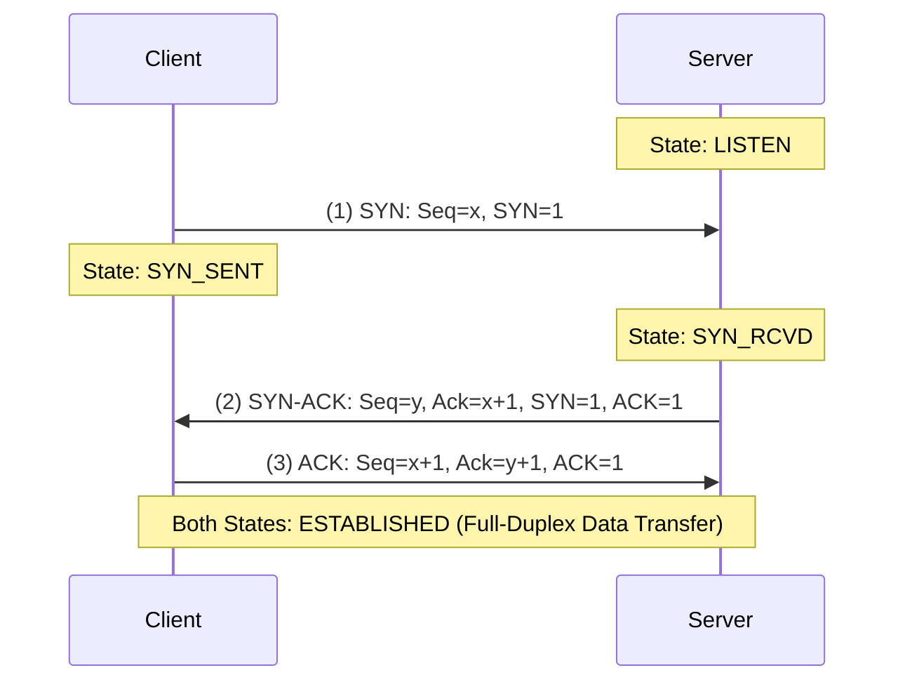

# 6. Scenarios for Establishing a Connection Using Three-Way Handshake

## Introduction

**TCP (Transmission Control Protocol)** is a connection-oriented protocol that requires both the client and server to synchronize their **Initial Sequence Numbers (ISNs)** and allocate buffer resources before exchanging application data. Because the underlying IP network can delay, duplicate, or drop packets, TCP uses a **Three-Way Handshake** (`SYN`, `SYN-ACK`, `ACK`) to establish a reliable full-duplex connection.

---

## Scenario 1: Normal Connection Establishment (Standard 3-Way Handshake)

In the standard client–server scenario, the server passively waits in the `LISTEN` state, and the client initiates the connection:

1. **Step 1 — `SYN` (Client $\rightarrow$ Server):**
   * The client chooses a random Initial Sequence Number `Seq = x` and sends a segment with the **`SYN = 1`** flag set.
   * Client state changes from `CLOSED` to `SYN_SENT`.
2. **Step 2 — `SYN-ACK` (Server $\rightarrow$ Client):**
   * The server receives the `SYN`, allocates resources, chooses its own random Initial Sequence Number `Seq = y`, and replies with **`SYN = 1, ACK = 1`**, setting **`Ack = x + 1`** (acknowledging the client's `SYN`, which consumes 1 sequence number).
   * Server state changes from `LISTEN` to `SYN_RCVD`.
3. **Step 3 — `ACK` (Client $\rightarrow$ Server):**
   * The client receives the `SYN-ACK`, transitions to `ESTABLISHED`, and sends an **`ACK = 1`** segment with **`Seq = x + 1`** and **`Ack = y + 1`**.
   * Upon receiving this `ACK`, the server also transitions to `ESTABLISHED`. Data transfer can now begin.



---

## Scenario 2: Rejecting a Delayed Duplicate `SYN` Packet

A primary reason TCP uses a **3-way** (rather than 2-way) handshake is to protect against **old, delayed duplicate `SYN` packets** from an earlier connection arriving late at the server:

1. An old, delayed duplicate `SYN` (`Seq = x_old`) arrives at the server while it is in `LISTEN`.
2. The server thinks a new connection is requested, replies with `SYN-ACK` (`Seq = y, Ack = x_old + 1`), and enters `SYN_RCVD`.
3. When this `SYN-ACK` reaches the client, the client knows it did **not** initiate a connection with `x_old`.
4. Instead of sending an `ACK`, the client sends a **`RST` (Reset)** segment (`Seq = x_old + 1`), causing the server to discard the half-open connection and return to `LISTEN`.

```text
Client                                   Server (LISTEN)
  |                                             |
  | <---- (Old Delayed SYN: Seq=x_old) -------->|  Server enters SYN_RCVD
  |                                             |
  | <---- SYN-ACK (Seq=y, Ack=x_old+1) ---------|
  |                                             |
  |------ RST (Seq=x_old+1) ------------------->|  Server aborts & returns to LISTEN
```

---

## Scenario 3: Simultaneous Open (Both Hosts Send `SYN` at the Same Time)

Two applications may attempt to connect to each other simultaneously (both issuing active opens):

1. Host A sends `SYN (Seq = x)` and enters `SYN_SENT`.
2. Host B simultaneously sends `SYN (Seq = y)` and enters `SYN_SENT`.
3. Each host receives the other's `SYN` while in `SYN_SENT`, transitions to `SYN_RCVD`, and sends `SYN-ACK` (`Ack = peer_seq + 1`).
4. Both hosts receive the `SYN-ACK` and transition to `ESTABLISHED` (forming a single connection rather than two).

---

## Scenario 4: Handling Lost `SYN` or `SYN-ACK` (Timeout & Retransmission)

* **Lost `SYN`:** If the initial `SYN` is dropped in the network, the client's retransmission timer expires in `SYN_SENT`, and the client resends the `SYN` (using exponential backoff).
* **Lost `SYN-ACK`:** If the server's `SYN-ACK` is lost, the server's timer expires in `SYN_RCVD` and it retransmits `SYN-ACK`; simultaneously, the client's `SYN` timer may expire and resend `SYN`.

---

## Summary of TCP Connection States During Handshake

| State | Meaning |
| :--- | :--- |
| **`CLOSED`** | No connection exists. |
| **`LISTEN`** | Server is passively waiting for an incoming `SYN`. |
| **`SYN_SENT`** | Client has sent `SYN` and is waiting for `SYN-ACK`. |
| **`SYN_RCVD`** | Server has received `SYN`, sent `SYN-ACK`, and is waiting for final `ACK`. |
| **`ESTABLISHED`** | Handshake complete; full-duplex data transfer is active. |

---

## References & Study Hints

* **GeeksforGeeks — TCP Connection Establishment (3-Way Handshake):** [https://www.geeksforgeeks.org/computer-networks/tcp-connection-establishment/](https://www.geeksforgeeks.org/computer-networks/tcp-connection-establishment/)
* **GeeksforGeeks — Three-Way Handshake Questions:** [https://www.geeksforgeeks.org/questions/consider-the-three-way-handshake-mechanism-followed-during-tcp-connection/](https://www.geeksforgeeks.org/questions/consider-the-three-way-handshake-mechanism-followed-during-tcp-connection/)
* **Exam Tip (5–10 Marks):** Draw the standard 3-step sequence diagram (`Seq=x`, `Ack=x+1 / Seq=y`, `Ack=y+1`), explain the **delayed duplicate `SYN` + `RST`** scenario (why 2-way handshake fails!), and include **Simultaneous Open** and **Lost Packet** scenarios.
