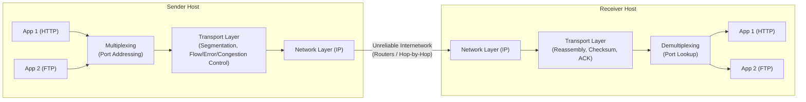

# 1. Design Issues in the Transport Layer

## Introduction

The **Transport Layer** (Layer 4 of the OSI model and Layer 3 of the TCP/IP model) provides **end-to-end (process-to-process) communication** between application processes running on different host machines. While the Network Layer (IP) provides best-effort **host-to-host** packet delivery, the Transport Layer builds upon it to deliver reliable, ordered, and efficient data transfer services to the upper layers.

Because the transport layer operates across an entire internetwork (rather than a single physical link like the Data Link Layer), its design must address several critical challenges.

---

## Core Design Issues in the Transport Layer

### 1. Addressing (Port Numbers / TSAPs)
* **Issue:** Multiple application processes run concurrently on a single host sharing one IP address. The network layer only identifies the destination host, not the specific application.
* **Solution:** The transport layer uses **Transport Service Access Points (TSAPs)**, commonly implemented as **16-bit Port Numbers** (0–65535).
  * *Well-known ports (0–1023):* HTTP (80), HTTPS (443), FTP (20/21), SMTP (25), DNS (53).
  * *Ephemeral/Dynamic ports:* Assigned temporarily to client processes.

### 2. Multiplexing and Demultiplexing
* **Issue:** Multiple outgoing data streams from different applications must share the single underlying network interface, and incoming segments must be routed to the correct application process.
* **Solution:**
  * **Multiplexing (Sender):** Gathering data chunks from multiple sockets, encapsulating each with a transport header (containing source and destination port numbers), and passing them to the network layer.
  * **Demultiplexing (Receiver):** Examining the destination port (and source IP/port in TCP) in the transport header to deliver each segment to the appropriate socket.

### 3. Connection Establishment and Release (Connection Management)
* **Issue:** For connection-oriented protocols (like TCP), establishing and tearing down a connection over an unreliable network that can lose, delay, or duplicate packets is non-trivial.
  * *Delayed Duplicates Problem:* Old packets from a previous connection can arrive late and be mistaken for a new connection request.
  * *Abrupt Termination (Two-Army Problem):* Closing a connection abruptly can cause data loss if one side still has unacknowledged data in transit.
* **Solution:**
  * **Connection Establishment:** Use a **Three-Way Handshake** (`SYN`, `SYN-ACK`, `ACK`) with randomly chosen Initial Sequence Numbers (ISNs) and timers to prevent old duplicates from opening false connections.
  * **Connection Release:** Use **Symmetric Release** (e.g., TCP's four-way `FIN`/`ACK` handshake) so both sides independently close their sending channels after all data is acknowledged.

### 4. Error Control and Reliability
* **Issue:** The underlying network layer (IP) is unreliable—segments may be corrupted, lost, duplicated, or delivered out of order.
* **Solution:**
  * **Error Detection:** A **16-bit Checksum** (covering the transport header, payload, and a network pseudo-header) detects bit errors.
  * **Sequencing:** **Sequence Numbers** allow the receiver to reorder out-of-order segments and discard duplicates.
  * **Acknowledgments & Retransmission (ARQ):** Positive acknowledgments (`ACK`), cumulative/selective ACKs, and retransmission timers (**RTO**) ensure lost segments are resent.

### 5. Flow Control
* **Issue:** A fast sender can transmit segments faster than a slow receiver can process them or store them in its receive buffer, causing buffer overflow and packet drops.
* **Solution:**
  * **Sliding Window Protocol:** The receiver advertises its available buffer space using a **Window Size (`rwnd`)** field in every returning segment. The sender restricts its unacknowledged bytes in flight to stay within this advertised window.

### 6. Congestion Control
* **Issue:** Even if the receiver has plenty of buffer space, intermediate routers in the network can become overloaded when multiple senders inject too much traffic simultaneously, leading to severe queuing delays and packet drops.
* **Solution:**
  * Maintain a **Congestion Window (`cwnd`)** at the sender (sending rate bounded by $\min(cwnd, rwnd)$).
  * Use closed-loop algorithms such as **Slow Start**, **Congestion Avoidance (AIMD — Additive Increase, Multiplicative Decrease)**, **Fast Retransmit**, and **Fast Recovery**, or Explicit Congestion Notification (**ECN**).

### 7. Buffering and Resource Management
* **Issue:** Deciding whether buffers should be allocated dynamically or statically, and whether buffering should happen at the sender, receiver, or both.
* **Solution:**
  * For low-bandwidth bursty traffic, dynamically allocated variable-sized buffers are efficient; for high-bandwidth streaming traffic, fixed-size circular buffers at both sender (for retransmission) and receiver (for out-of-order reassembly) minimize overhead.

### 8. Quality of Service (QoS) and Crash Recovery
* **Issue:** Different applications have conflicting needs (e.g., file transfer demands 100% reliability; VoIP/video streaming prioritizes low latency and jitter over zero loss). Also, if a host or router crashes, active transport connections must recover cleanly or reset.
* **Solution:** Offer distinct transport services (e.g., **TCP** for reliability vs. **UDP** for low-latency datagrams) and use **RST (Reset)** flags and keep-alive timers for crash detection.

---

## Architecture Diagram: End-to-End Transport Layer Role

---

## Comparison: Data Link Layer vs. Transport Layer Design

| Aspect | Data Link Layer (Layer 2) | Transport Layer (Layer 4) |
| :--- | :--- | :--- |
| **Scope** | Hop-to-hop (adjacent nodes over a single link) | End-to-end (process-to-process across the entire network) |
| **Addressing** | Physical MAC addresses | Logical Port numbers (TSAPs) |
| **Environment** | Known, predictable physical link | Unknown, heterogeneous internetwork with variable delays |
| **Connection Setup** | Usually not required (or simple link setup) | Complex (e.g., 3-Way Handshake to handle delayed duplicates) |
| **Buffering** | Simple, small fixed buffers per link | Complex dynamic buffering for many concurrent connections |

---

## References & Study Hints

* **GeeksforGeeks — Transport Layer Services & Design:** [https://www.geeksforgeeks.org/computer-organization-architecture/transport-layer-services/](https://www.geeksforgeeks.org/computer-organization-architecture/transport-layer-services/)
* **YouTube Lecture (Transport Layer Design Issues):** [https://www.youtube.com/watch?v=7jUWxFV1VHU](https://www.youtube.com/watch?v=7jUWxFV1VHU)
* **Exam Tip (5–10 Marks):** Always mention **end-to-end** vs. **hop-to-hop** distinction, list at least 6 core design issues (Addressing, Multiplexing, Connection Management, Error Control, Flow Control, Congestion Control), and include the sender-to-receiver diagram.
