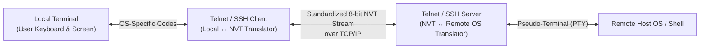

# 14. Virtual Terminal and Its Significance in Networks

## Introduction

A **Virtual Terminal**—specifically standardized in TCP/IP as the **Network Virtual Terminal (NVT)**—is a software-based logical abstraction of a physical terminal device. It provides a **universal, standardized interface** (character set, keyboard codes, and control sequences) so that a user on any local computer can log in to and interact with a remote host over a network, regardless of differences in hardware or operating systems.

**Telnet** (TCP Port 23) and **SSH** (TCP Port 22) are classic application-layer protocols built around the virtual terminal concept.

---

## 1. The Heterogeneity Problem (Why Virtual Terminals Exist)

Without a virtual terminal standard, a network with $M$ different types of client terminals (Windows, Linux, macOS, VT100, IBM 3270) and $N$ different types of remote servers would require **$M \times N$ separate terminal translators**.

With a **Network Virtual Terminal (NVT)** as a common intermediate standard, each client only needs **1** translator (Local $\leftrightarrow$ NVT) and each server only needs **1** translator (NVT $\leftrightarrow$ Server OS), reducing complexity from $M \times N$ to **$M + N$**.

---

## 2. How NVT Works (Translation Pipeline)

1. **Client Side:** When the user presses keys on their local keyboard, the client driver translates the local character/control codes into **NVT format** and transmits them over TCP.
2. **Server Side:** The remote server receives the NVT stream, translates it into the format expected by the remote OS (via a pseudo-terminal), and executes the command.
3. **Return Path:** Output from the remote application is converted back into NVT format by the server and translated by the client into local display commands.

---

## 3. NVT Data vs. Control Structure

NVT uses **8-bit bytes** to represent both printable data and terminal control commands:

* **Data Characters (`MSB = 0`):**
  * The 7 lower-order bits represent standard **7-bit US-ASCII** characters (codes `0`–`127`).
  * Line endings are standardized as **`CR` + `LF`** (Carriage Return followed by Line Feed).
* **Control Characters (`MSB = 1`):**
  * Bytes with the most significant bit set to `1` represent control signals (e.g., `IAC` — *Interpret As Command* `255`, Interrupt Process `IP`, Erase Character `EC`, Are You There `AYT`).

---

## 4. Significance of Virtual Terminals in Computer Networks

1. **Cross-Platform Interoperability:** Allows any client terminal to communicate seamlessly with mainframes, UNIX/Linux servers, Cisco routers, and switches without knowing the remote hardware's native terminal language.
2. **Remote System Administration:** Enables network engineers and sysadmins to configure routers, troubleshoot servers, and execute CLI commands from anywhere in the world.
3. **Decoupling Hardware from Software:** Applications only need to support one standard virtual interface rather than maintaining drivers for hundreds of physical terminal models.
4. **Reduced Protocol Complexity:** Simplifies client–server design from $M \times N$ pairwise translators to $M + N$ translators.

### Security Note: Telnet vs. SSH
* **Telnet (Port 23)** transmits all NVT data—including usernames and passwords—in **plain text**, making it insecure on public networks.
* **SSH (Secure Shell, Port 22)** provides the same virtual terminal functionality over an **encrypted** and authenticated channel, replacing Telnet in modern production environments.

---

## References & Study Hints

* **GeeksforGeeks — What is Network Virtual Terminal (NVT) in Telnet:** [https://www.geeksforgeeks.org/computer-networks/what-is-network-virtual-terminal-in-telnet/](https://www.geeksforgeeks.org/computer-networks/what-is-network-virtual-terminal-in-telnet/)
* **GeeksforGeeks — Introduction to Telnet:** [https://www.geeksforgeeks.org/computer-networks/introduction-to-telnet/](https://www.geeksforgeeks.org/computer-networks/introduction-to-telnet/)
* **Exam Tip (5–10 Marks):** Explain the **$M \times N \rightarrow M + N$** heterogeneity problem, draw the **Local $\leftrightarrow$ NVT $\leftrightarrow$ Remote** translation diagram, distinguish **Data (`MSB=0`) vs. Control (`MSB=1`)** bytes, and mention **SSH** as the secure successor to **Telnet**.
