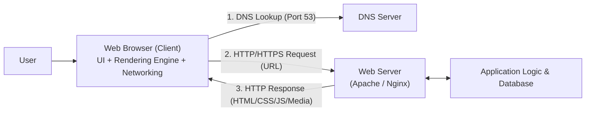

# 17. Concept of World Wide Web (WWW) and Its Components

## Introduction

The **World Wide Web (WWW)**—invented by **Tim Berners-Lee** at CERN in 1989—is a global, distributed information system of interconnected **hypertext documents** and multimedia resources accessed over the Internet.

> **WWW vs. Internet:** The **Internet** is the underlying global hardware and network infrastructure (routers, cables, TCP/IP), whereas the **WWW** is an application-layer **information service** running on top of the Internet.

---

## Architecture of the World Wide Web

The WWW operates on a **Client–Server Architecture**:
* **Web Client (Browser):** Requests resources from servers and renders them for the user.
* **Web Server:** Stores web resources (HTML, CSS, JS, images, backend apps), processes incoming requests, and returns responses.



---

## Core Components of the World Wide Web

The WWW relies on four foundational pillars working together:

### 1. Web Browser (Client Software)
* **Role:** Acts as the user's interface to the Web (e.g., Google Chrome, Mozilla Firefox, Microsoft Edge, Safari).
* **Key Internal Subsystems:**
  * **User Interface (UI):** Address bar, navigation buttons, bookmarks.
  * **Browser Engine:** Coordinates actions between the UI and rendering engine.
  * **Rendering Engine:** Parses **HTML** and **CSS** to paint the visual webpage on screen.
  * **JavaScript Interpreter:** Executes client-side scripts for interactivity.
  * **Networking Layer:** Sends HTTP/HTTPS requests and receives responses.

### 2. Web Server (Host Software/Hardware)
* **Role:** A remote host running server software (e.g., Apache HTTP Server, Nginx, IIS) that listens on Port 80/443, processes HTTP requests, interacts with backend databases for dynamic pages, and serves static/dynamic content.

### 3. URL (Uniform Resource Locator)
* **Role:** The unique global address used to locate any resource on the Web.
* **Structure of a URL:**
  ```text
  https://www.example.com:443/docs/page.html?id=10#section2
  \___/   \_____________/ \_/\_____________/ \____/ \_______/
  Scheme     Hostname     Port     Path       Query  Fragment
  ```
  * **Scheme/Protocol:** `http://` or `https://`.
  * **Hostname/Domain:** Resolved via DNS to an IP address.
  * **Path:** Location of the specific file or endpoint on the server.

### 4. HTTP / HTTPS (Hypertext Transfer Protocol)
* **Role:** The stateless application-layer communication protocol governing how browsers and servers format and exchange requests and responses. **HTTPS** wraps HTTP inside **TLS/SSL** encryption for confidentiality and integrity.

### 5. HTML (Hypertext Markup Language)
* **Role:** The standard markup language used to structure web documents. It uses tags (`<h1>`, `<p>`, ``, `<a>`) and **hyperlinks** to connect documents across different servers, creating the interconnected "web" of information. *(Complemented by **CSS** for styling and **JavaScript** for dynamic behavior.)*

---

## End-to-End Working of the WWW (Step-by-Step)

1. User types a **URL** into the **Web Browser**.
2. Browser uses **DNS** to translate the domain name into the **Web Server's** IP address.
3. Browser opens a TCP (and TLS for HTTPS) connection and sends an **HTTP Request**.
4. **Web Server** processes the request and returns an **HTTP Response** containing the **HTML** document (plus linked CSS/JS/media).
5. Browser's rendering engine parses the **HTML** and displays the interactive webpage, allowing the user to click **hyperlinks** to repeat the cycle.

---

## References & Study Hints

* **GeeksforGeeks — World Wide Web (WWW):** [https://www.geeksforgeeks.org/computer-networks/world-wide-web-www/](https://www.geeksforgeeks.org/computer-networks/world-wide-web-www/)
* **MDN Web Docs — HTTP & Web Overview:** [https://developer.mozilla.org/en-US/docs/Web/HTTP](https://developer.mozilla.org/en-US/docs/Web/HTTP)
* **Exam Tip (5–10 Marks):** Start by distinguishing **WWW vs. Internet**, draw the **Client–Server WWW architecture diagram**, and clearly explain all core components (**Web Browser, Web Server, URL, HTTP/HTTPS, HTML/Hypertext**) along with the 5-step page-load flow.
